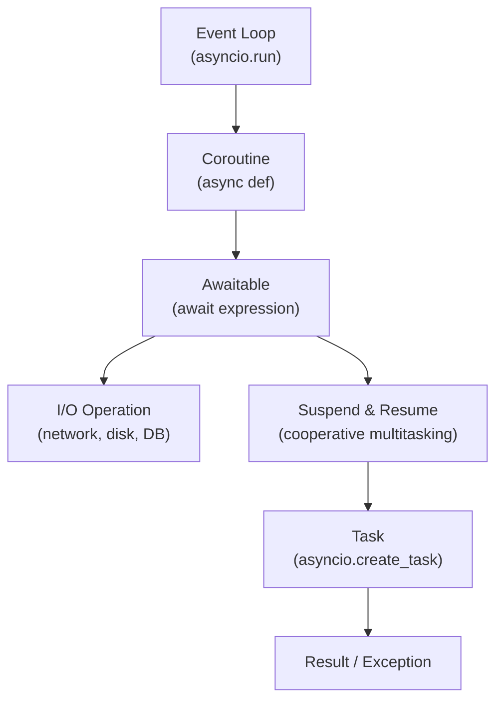
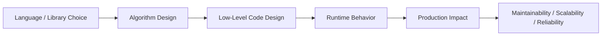

# Asynchronous Programming in Python

## Overview

Asynchronous programming allows a Python program to handle many concurrent operations without blocking — particularly I/O-bound tasks like network requests, database queries, and file operations. Python's `asyncio` library, introduced in Python 3.4 and matured in 3.7+, provides an event loop, coroutines, tasks, and async-compatible I/O primitives.

Mastering `asyncio` is essential for building high-performance APIs, AI agent orchestration systems, RAG pipelines, and any backend service that handles many concurrent I/O operations.

---

## Conceptual Flow





---

## Key Concepts

| Concept | Description |
|---|---|
| `async def` | Defines a coroutine function |
| `await` | Suspends the coroutine until the awaitable completes |
| `asyncio.run()` | Runs the top-level coroutine and manages the event loop |
| `asyncio.create_task()` | Schedules a coroutine to run concurrently |
| `asyncio.gather()` | Runs multiple awaitables concurrently, collects results |
| `asyncio.Queue` | Async-safe queue for producer-consumer patterns |
| `asyncio.Semaphore` | Limits concurrent coroutines |
| `asyncio.Event` | Async signaling between coroutines |

---

## Simple Example

### Basic Coroutine and `await`

```python
import asyncio
import time


async def fetch_data(name: str, delay: float) -> str:
    print(f"[{name}] Starting fetch...")
    await asyncio.sleep(delay)   # Non-blocking sleep (simulates I/O)
    print(f"[{name}] Done after {delay}s")
    return f"Data from {name}"


async def main() -> None:
    start = time.perf_counter()

    # Run concurrently with gather
    results = await asyncio.gather(
        fetch_data("API-1", 1.0),
        fetch_data("API-2", 1.5),
        fetch_data("API-3", 0.5),
    )

    elapsed = time.perf_counter() - start
    print(f"\nResults: {results}")
    print(f"Total time: {elapsed:.2f}s (sequential would take 3.0s)")


asyncio.run(main())
```

**Explanation:**
- `async def` defines a coroutine — a function that can be suspended and resumed.
- `await asyncio.sleep()` yields control back to the event loop, allowing other coroutines to run.
- `asyncio.gather()` runs all three coroutines concurrently — total time ≈ max(1.0, 1.5, 0.5) = 1.5s.

**Expected Output:**
```
[API-1] Starting fetch...
[API-2] Starting fetch...
[API-3] Starting fetch...
[API-3] Done after 0.5s
[API-1] Done after 1.0s
[API-2] Done after 1.5s

Results: ['Data from API-1', 'Data from API-2', 'Data from API-3']
Total time: 1.51s (sequential would take 3.0s)
```

---

## Intermediate Example

### Async HTTP Client with `aiohttp` and Rate Limiting

```python
import asyncio
import aiohttp
import time
from typing import List


async def fetch_url(
    session: aiohttp.ClientSession,
    url: str,
    semaphore: asyncio.Semaphore,
) -> dict:
    async with semaphore:   # Limit to N concurrent requests
        try:
            async with session.get(url, timeout=aiohttp.ClientTimeout(total=10)) as response:
                text = await response.text()
                return {"url": url, "status": response.status, "length": len(text)}
        except Exception as exc:
            return {"url": url, "status": -1, "error": str(exc)}


async def fetch_all(urls: List[str], max_concurrent: int = 5) -> List[dict]:
    semaphore = asyncio.Semaphore(max_concurrent)
    async with aiohttp.ClientSession() as session:
        tasks = [fetch_url(session, url, semaphore) for url in urls]
        return await asyncio.gather(*tasks)


async def main() -> None:
    urls = [
        "https://httpbin.org/get",
        "https://httpbin.org/status/200",
        "https://httpbin.org/delay/1",
        "https://httpbin.org/json",
        "https://httpbin.org/uuid",
    ]

    start = time.perf_counter()
    results = await fetch_all(urls, max_concurrent=3)
    elapsed = time.perf_counter() - start

    for r in results:
        print(f"  {r['url'][-30:]} -> {r.get('status')} ({r.get('length', 0)} bytes)")
    print(f"\nFetched {len(results)} URLs in {elapsed:.2f}s")


asyncio.run(main())
```

**Explanation:**
- `aiohttp` is the standard async HTTP client for Python.
- `asyncio.Semaphore(5)` limits concurrent requests to 5, preventing server overload.
- `async with session.get(...)` is a non-blocking HTTP request.
- All requests run concurrently within the semaphore limit.

**Expected Output:**
```
  ...httpbin.org/get -> 200 (XXX bytes)
  ...httpbin.org/status/200 -> 200 (0 bytes)
  ...
Fetched 5 URLs in ~1.Xs
```

---

## Advanced / Architect-Level Example

### Async RAG Pipeline with Task Orchestration

**Problem Context:**
A RAG pipeline needs to: (1) retrieve relevant documents from a vector DB, (2) fetch additional context from external APIs, and (3) generate a response — all concurrently where possible, with timeout handling and structured error recovery.

```python
from __future__ import annotations
import asyncio
import time
import logging
from dataclasses import dataclass, field
from typing import List, Optional

logging.basicConfig(level=logging.INFO, format="%(asctime)s | %(name)s | %(message)s")
logger = logging.getLogger("rag_pipeline")


@dataclass
class RetrievedDoc:
    doc_id: str
    content: str
    score: float


@dataclass
class RAGContext:
    query: str
    retrieved_docs: List[RetrievedDoc] = field(default_factory=list)
    external_context: Optional[str] = None
    response: Optional[str] = None
    errors: List[str] = field(default_factory=list)


# --- Simulated async services ---

async def retrieve_documents(query: str, top_k: int = 3) -> List[RetrievedDoc]:
    """Simulate async vector DB retrieval."""
    await asyncio.sleep(0.2)   # Simulate DB latency
    return [
        RetrievedDoc(doc_id=f"doc_{i}", content=f"Relevant content {i} for: {query}", score=1.0 - i * 0.1)
        for i in range(top_k)
    ]


async def fetch_external_context(query: str) -> str:
    """Simulate async external API call."""
    await asyncio.sleep(0.3)   # Simulate API latency
    return f"External context for: {query}"


async def generate_response(context: RAGContext) -> str:
    """Simulate async LLM call."""
    await asyncio.sleep(0.5)   # Simulate LLM latency
    doc_summary = "; ".join(d.content[:30] for d in context.retrieved_docs[:2])
    return f"Response to '{context.query}' based on: [{doc_summary}]"


# --- Pipeline orchestration ---

async def run_rag_pipeline(query: str, timeout: float = 2.0) -> RAGContext:
    ctx = RAGContext(query=query)
    logger.info(f"Starting RAG pipeline for: '{query}'")

    # Step 1: Retrieve docs and fetch external context CONCURRENTLY
    try:
        retrieve_task = asyncio.create_task(retrieve_documents(query))
        external_task = asyncio.create_task(fetch_external_context(query))

        # Wait for both with a timeout
        done, pending = await asyncio.wait(
            {retrieve_task, external_task},
            timeout=timeout,
        )

        # Cancel timed-out tasks
        for task in pending:
            task.cancel()
            ctx.errors.append(f"Task {task.get_name()} timed out")

        if retrieve_task in done:
            ctx.retrieved_docs = retrieve_task.result()
            logger.info(f"Retrieved {len(ctx.retrieved_docs)} documents")
        else:
            ctx.errors.append("Document retrieval timed out")

        if external_task in done:
            ctx.external_context = external_task.result()
            logger.info("External context fetched")

    except Exception as exc:
        ctx.errors.append(f"Retrieval phase error: {exc}")
        logger.error(f"Retrieval error: {exc}")

    # Step 2: Generate response (depends on retrieval results)
    if ctx.retrieved_docs:
        try:
            ctx.response = await asyncio.wait_for(
                generate_response(ctx),
                timeout=1.0,
            )
            logger.info("Response generated")
        except asyncio.TimeoutError:
            ctx.errors.append("LLM generation timed out")
            ctx.response = "Response generation timed out."
    else:
        ctx.response = "No documents retrieved; cannot generate response."

    return ctx


async def main() -> None:
    queries = [
        "What is retrieval-augmented generation?",
        "How does vector similarity search work?",
        "Explain transformer attention mechanisms",
    ]

    start = time.perf_counter()

    # Process all queries concurrently
    tasks = [run_rag_pipeline(q) for q in queries]
    results = await asyncio.gather(*tasks, return_exceptions=True)

    elapsed = time.perf_counter() - start
    print(f"\n{'='*60}")
    for ctx in results:
        if isinstance(ctx, Exception):
            print(f"Pipeline error: {ctx}")
        else:
            print(f"Query: {ctx.query[:40]}")
            print(f"  Docs: {len(ctx.retrieved_docs)} | Errors: {ctx.errors}")
            print(f"  Response: {ctx.response[:60]}...")
    print(f"\nProcessed {len(queries)} queries in {elapsed:.2f}s")


asyncio.run(main())
```

**Explanation:**
- `asyncio.create_task()` schedules retrieval and external context fetch concurrently.
- `asyncio.wait()` with `timeout` handles partial completion gracefully.
- `asyncio.wait_for()` applies a per-operation timeout to LLM generation.
- `return_exceptions=True` in `gather()` prevents one failure from cancelling all queries.
- The pipeline is fully non-blocking — all three queries run concurrently.

**Design Trade-offs:**
| Approach | Pros | Cons |
|---|---|---|
| `asyncio.gather()` | Simple, concurrent | One exception cancels all (unless `return_exceptions=True`) |
| `asyncio.wait()` | Fine-grained control, partial results | More verbose |
| `asyncio.TaskGroup` (3.11+) | Structured concurrency, auto-cancel | Python 3.11+ only |
| `anyio` | Backend-agnostic (asyncio/trio) | Extra dependency |

---

## Common Mistakes

### 1. Calling Blocking Code in a Coroutine
- **Problem:** Calling `time.sleep()`, `requests.get()`, or any blocking I/O inside `async def` blocks the entire event loop.
- **Better Approach:** Use `await asyncio.sleep()`, `aiohttp`, `asyncpg`, etc. For unavoidable blocking calls, use `asyncio.to_thread()`.

```python
# Blocks the event loop!
async def bad():
    time.sleep(1)

# Non-blocking
async def good():
    await asyncio.sleep(1)

# For blocking code you can't avoid
async def run_blocking():
    result = await asyncio.to_thread(blocking_function, arg1, arg2)
```

### 2. Forgetting `await`
- **Problem:** Calling a coroutine without `await` returns a coroutine object, not the result. Python 3.11+ warns about this.
- **Better Approach:** Always `await` coroutine calls.

```python
# Bug: result is a coroutine object, not the data
result = fetch_data()

# Correct
result = await fetch_data()
```

### 3. Using `asyncio.run()` Inside an Already-Running Event Loop
- **Problem:** Calling `asyncio.run()` inside a Jupyter notebook or another async context raises `RuntimeError`.
- **Better Approach:** Use `await` directly in async contexts, or use `nest_asyncio` for notebooks.

### 4. Not Handling Task Cancellation
- **Problem:** Cancelled tasks raise `asyncio.CancelledError`. Catching `Exception` without re-raising `CancelledError` breaks cancellation.
- **Better Approach:** Catch `asyncio.CancelledError` separately and re-raise it.

```python
async def worker():
    try:
        await some_operation()
    except asyncio.CancelledError:
        # Cleanup
        raise   # Always re-raise CancelledError
    except Exception as exc:
        handle_error(exc)
```

### 5. Creating Tasks Without Storing References
- **Problem:** Tasks created with `asyncio.create_task()` can be garbage-collected if no reference is kept.
- **Better Approach:** Store task references in a set or list.

```python
# Risky: task may be GC'd
asyncio.create_task(background_job())

# Safe
tasks = set()
task = asyncio.create_task(background_job())
tasks.add(task)
task.add_done_callback(tasks.discard)
```

### 6. Mixing `async` and Sync Code Incorrectly
- **Problem:** Calling `async` functions from sync code without `asyncio.run()` or using sync libraries in async code.
- **Better Approach:** Use `asyncio.run()` as the entry point; use async-compatible libraries throughout.

---

## Best Practices

- **Use `asyncio.run()`** as the single entry point for async programs.
- **Use `asyncio.create_task()`** to run coroutines concurrently without blocking.
- **Use `asyncio.gather(return_exceptions=True)`** to handle partial failures gracefully.
- **Apply timeouts** with `asyncio.wait_for()` to every external I/O operation.
- **Use `asyncio.Semaphore`** to rate-limit concurrent operations (API calls, DB queries).
- **Use `asyncio.Queue`** for async producer-consumer pipelines.
- **Use `asyncio.to_thread()`** to run blocking code without blocking the event loop.
- **Use `TaskGroup` (Python 3.11+)** for structured concurrency with automatic cancellation.
- **Use async context managers** (`async with`) for resource management (sessions, connections).
- **Use `async for`** for async iterators (streaming responses, async generators).

---

## Performance Considerations

- **asyncio is single-threaded:** It handles concurrency through cooperative multitasking, not parallelism. One CPU core is used.
- **Ideal for high-concurrency I/O:** A single asyncio event loop can handle thousands of concurrent connections with minimal memory overhead.
- **Not for CPU-bound work:** CPU-intensive code blocks the event loop. Use `asyncio.to_thread()` or `ProcessPoolExecutor` for CPU work.
- **`uvloop`:** A drop-in replacement for the default asyncio event loop, implemented in Cython/libuv. Provides 2–4× throughput improvement.
- **Connection pooling:** Use async connection pools (`asyncpg`, `aioredis`) to reuse connections across coroutines.
- **Avoid `asyncio.sleep(0)`:** While it yields control, excessive use adds overhead. Use it only when necessary.

```python
# Install uvloop for production
import uvloop
asyncio.set_event_loop_policy(uvloop.EventLoopPolicy())
```

---

## Testing Strategy

```python
import asyncio
import pytest
import pytest_asyncio   # pip install pytest-asyncio


# --- Code under test ---
async def fetch_with_retry(url: str, retries: int = 3) -> str:
    for attempt in range(retries):
        try:
            await asyncio.sleep(0.01)   # Simulate I/O
            if attempt < 1:
                raise ConnectionError("Simulated failure")
            return f"Success from {url}"
        except ConnectionError:
            if attempt == retries - 1:
                raise
    return ""


# --- Tests ---

@pytest.mark.asyncio
async def test_fetch_succeeds_after_retry():
    result = await fetch_with_retry("https://example.com")
    assert result == "Success from https://example.com"


@pytest.mark.asyncio
async def test_gather_runs_concurrently():
    async def task(delay: float) -> float:
        await asyncio.sleep(delay)
        return delay

    start = asyncio.get_event_loop().time()
    results = await asyncio.gather(task(0.1), task(0.1), task(0.1))
    elapsed = asyncio.get_event_loop().time() - start

    assert results == [0.1, 0.1, 0.1]
    assert elapsed < 0.3, "Tasks should run concurrently"


@pytest.mark.asyncio
async def test_timeout_raises():
    async def slow_task():
        await asyncio.sleep(10)

    with pytest.raises(asyncio.TimeoutError):
        await asyncio.wait_for(slow_task(), timeout=0.1)


@pytest.mark.asyncio
async def test_semaphore_limits_concurrency():
    semaphore = asyncio.Semaphore(2)
    active = 0
    max_active = 0

    async def task():
        nonlocal active, max_active
        async with semaphore:
            active += 1
            max_active = max(max_active, active)
            await asyncio.sleep(0.05)
            active -= 1

    await asyncio.gather(*[task() for _ in range(10)])
    assert max_active <= 2
```

> **Setup:** Add `asyncio_mode = "auto"` to `pytest.ini` or use `@pytest.mark.asyncio` decorator.

---

## Debugging Tips

- **`asyncio.get_event_loop().set_debug(True)`:** Enables debug mode — logs slow callbacks (>100ms), unawaited coroutines, and resource leaks.
- **`PYTHONASYNCIODEBUG=1`:** Environment variable to enable asyncio debug mode.
- **`asyncio.all_tasks()`:** Lists all running tasks — useful for detecting task leaks.
- **`task.get_name()` and `task.get_coro()`:** Identify tasks by name and coroutine for debugging.
- **`asyncio.current_task()`:** Returns the currently running task inside a coroutine.
- **Structured logging with task names:** Include `asyncio.current_task().get_name()` in log records.
- **`aiomonitor`:** A library that provides a live REPL for inspecting a running asyncio event loop.
- **Detect blocking calls:** Use `asyncio` debug mode — it warns when a callback takes longer than 100ms.

```python
import asyncio
import logging

logging.basicConfig(level=logging.DEBUG)
asyncio.get_event_loop().set_debug(True)
```

---

## Interview Questions

### Beginner
1. **What is a coroutine in Python?**
   A coroutine is a function defined with `async def` that can be suspended at `await` expressions and resumed later by the event loop.

2. **What does `await` do?**
   It suspends the current coroutine and yields control to the event loop until the awaitable (coroutine, task, or future) completes.

3. **What is `asyncio.run()`?**
   It creates an event loop, runs the given coroutine until completion, and closes the loop. It is the standard entry point for async programs.

4. **What is the difference between `asyncio.gather()` and sequential `await`?**
   Sequential `await` runs coroutines one after another. `asyncio.gather()` runs them concurrently, reducing total time to the maximum individual time.

5. **What is the event loop?**
   The event loop is the core of asyncio — it schedules and runs coroutines, handles I/O events, and manages callbacks.

### Intermediate
1. **What is the difference between `asyncio.create_task()` and `asyncio.gather()`?**
   `create_task()` schedules a coroutine as a background task immediately. `gather()` runs multiple awaitables concurrently and waits for all to complete.

2. **How do you run blocking code in an async context?**
   Use `await asyncio.to_thread(blocking_func, *args)` to run blocking code in a thread pool without blocking the event loop.

3. **What is `asyncio.Semaphore` used for?**
   Limiting the number of coroutines that can execute a section of code concurrently — e.g., rate-limiting API calls.

4. **What happens if you don't `await` a coroutine?**
   The coroutine is never executed. Python 3.11+ issues a `RuntimeWarning: coroutine was never awaited`.

5. **What is structured concurrency and how does `TaskGroup` implement it?**
   Structured concurrency ensures all tasks created within a scope are completed or cancelled before the scope exits. `asyncio.TaskGroup` (Python 3.11+) implements this — if any task fails, all others are cancelled.

### Advanced / Architect-Level
1. **How would you design an async RAG pipeline that handles partial failures gracefully?**
   Use `asyncio.gather(return_exceptions=True)` or `asyncio.wait()` to collect results and exceptions separately. Implement fallback strategies (cached results, degraded responses) for failed components.

2. **What is `uvloop` and when should you use it?**
   `uvloop` is a fast asyncio event loop implementation based on libuv. Use it in production for 2–4× throughput improvement on I/O-heavy services.

3. **How do you implement a circuit breaker pattern with asyncio?**
   Use a shared state object (protected by `asyncio.Lock`) tracking failure counts and timestamps. A background task periodically resets the breaker. Coroutines check the breaker state before making external calls.

4. **What are the trade-offs between asyncio and threading for a high-concurrency web service?**
   asyncio handles thousands of concurrent connections with minimal memory (one thread). Threading requires one thread per connection (~8MB each), limiting concurrency. asyncio is better for I/O-heavy services; threading is simpler for mixed workloads.

5. **How do you integrate asyncio with a synchronous ORM like SQLAlchemy?**
   Use `asyncio.to_thread()` to run synchronous ORM calls in a thread pool, or migrate to an async ORM like `SQLAlchemy 2.0` with `asyncpg` or `aiosqlite`.

---

## Key Takeaways

- `asyncio` enables high-concurrency I/O without threads, using cooperative multitasking.
- `async def` / `await` are the building blocks; `asyncio.run()` is the entry point.
- `asyncio.gather()` runs coroutines concurrently; `asyncio.create_task()` schedules background work.
- Always apply timeouts with `asyncio.wait_for()` to external I/O operations.
- Never call blocking code inside a coroutine — use `asyncio.to_thread()` for unavoidable blocking calls.
- `asyncio.Semaphore` is essential for rate-limiting concurrent operations.
- `uvloop` provides significant performance improvements for production async services.
- Structured concurrency (`TaskGroup`) makes async code safer and easier to reason about.

---

## Mini Project Idea

### Async AI Agent Orchestrator

**Goal:** Build an async orchestrator that runs multiple AI agent tasks concurrently — web search, document retrieval, and summarization — and aggregates their results.

**Features:**
- Define agent tasks as async coroutines.
- Run tasks concurrently with `asyncio.gather()`.
- Apply per-task timeouts with `asyncio.wait_for()`.
- Rate-limit external API calls with `asyncio.Semaphore`.
- Stream results progressively using `asyncio.Queue`.
- Log task execution with structured logging.

**Suggested Folder Structure:**
```
agent_orchestrator/
├── orchestrator/
│   ├── __init__.py
│   ├── agents.py          # Individual agent coroutines
│   ├── pipeline.py        # Orchestration logic (gather, wait)
│   ├── rate_limiter.py    # Semaphore-based rate limiter
│   └── streaming.py       # asyncio.Queue-based result streaming
├── tests/
│   ├── test_agents.py
│   └── test_pipeline.py
├── requirements.txt
└── README.md
```

**Extension Ideas:**
- Add retry logic with exponential backoff using `tenacity`.
- Implement a circuit breaker for external API calls.
- Add WebSocket streaming of results using FastAPI.
- Integrate with LangChain or LlamaIndex for real agent tasks.

---

## Final Summary

Asynchronous programming with `asyncio` is the foundation of modern, high-performance Python backends. It enables a single Python process to handle thousands of concurrent I/O operations — API calls, database queries, LLM requests — with minimal resource overhead. For AI architects building RAG pipelines, agent orchestration systems, and real-time APIs, `asyncio` is not optional — it is the standard. Mastering coroutines, tasks, semaphores, and structured concurrency patterns equips you to design systems that are fast, resilient, and scalable, capable of handling the concurrent demands of production AI and backend workloads.
