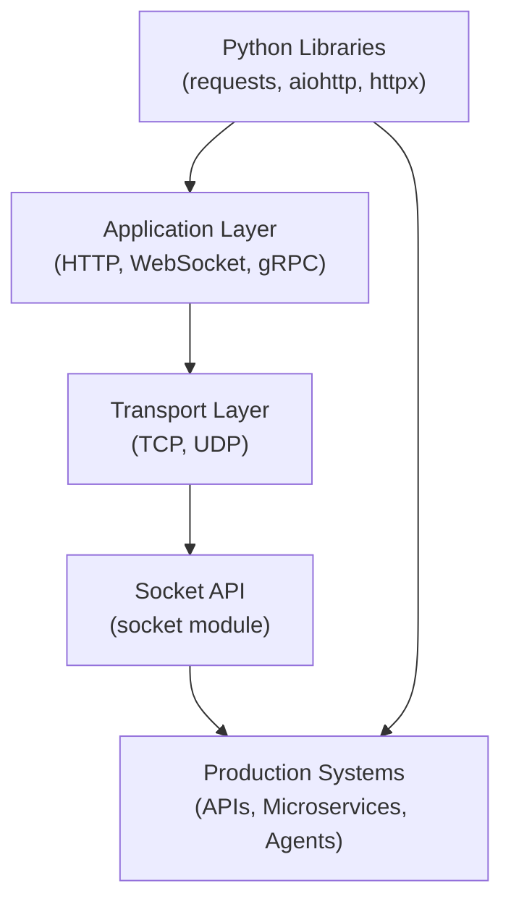

# Networking (Sockets, HTTP) in Python

## Overview

Networking in Python spans from low-level TCP/UDP socket programming to high-level HTTP clients and servers. Python's standard library provides `socket` for raw network communication and `http.client`/`urllib` for HTTP. Production systems typically use `requests` (sync) or `aiohttp`/`httpx` (async) for HTTP, and `asyncio` streams for custom protocols.

Understanding networking fundamentals — sockets, protocols, connection management, and HTTP semantics — is essential for building APIs, microservices, AI agent backends, and data pipelines that communicate over networks.

---

## Conceptual Flow




---

## Networking Library Landscape

| Library | Level | Sync/Async | Best For |
|---|---|---|---|
| `socket` | Low (TCP/UDP) | Sync | Custom protocols, learning |
| `http.client` | Medium (HTTP) | Sync | Stdlib HTTP |
| `urllib` | Medium (HTTP) | Sync | Simple HTTP requests |
| `requests` | High (HTTP) | Sync | REST APIs, scripting |
| `httpx` | High (HTTP) | Sync + Async | Modern REST, async support |
| `aiohttp` | High (HTTP) | Async | High-concurrency HTTP |
| `websockets` | High (WS) | Async | WebSocket clients/servers |
| `grpcio` | High (gRPC) | Sync + Async | Microservice RPC |

---

## Simple Example

### TCP Echo Server and Client with `socket`

```python
# server.py
import socket
import threading


def handle_client(conn: socket.socket, addr: tuple) -> None:
    print(f"[Server] Connected: {addr}")
    with conn:
        while True:
            data = conn.recv(1024)
            if not data:
                break
            print(f"[Server] Received: {data.decode()}")
            conn.sendall(b"Echo: " + data)
    print(f"[Server] Disconnected: {addr}")


def run_server(host: str = "127.0.0.1", port: int = 9000) -> None:
    with socket.socket(socket.AF_INET, socket.SOCK_STREAM) as server:
        server.setsockopt(socket.SOL_SOCKET, socket.SO_REUSEADDR, 1)
        server.bind((host, port))
        server.listen(5)
        print(f"[Server] Listening on {host}:{port}")
        while True:
            conn, addr = server.accept()
            thread = threading.Thread(target=handle_client, args=(conn, addr), daemon=True)
            thread.start()


# client.py (run separately or in a thread)
def run_client(host: str = "127.0.0.1", port: int = 9000) -> None:
    with socket.socket(socket.AF_INET, socket.SOCK_STREAM) as client:
        client.connect((host, port))
        messages = ["Hello", "World", "Goodbye"]
        for msg in messages:
            client.sendall(msg.encode())
            response = client.recv(1024)
            print(f"[Client] Response: {response.decode()}")


# Demo: run server in background, then client
if __name__ == "__main__":
    import time
    server_thread = threading.Thread(target=run_server, daemon=True)
    server_thread.start()
    time.sleep(0.1)   # Wait for server to start
    run_client()
```

**Explanation:**
- `socket.AF_INET` = IPv4; `socket.SOCK_STREAM` = TCP.
- `SO_REUSEADDR` allows reusing the port immediately after restart.
- Each client connection is handled in a separate thread.
- `conn.recv(1024)` reads up to 1024 bytes; returns empty bytes on disconnect.

**Expected Output:**
```
[Server] Listening on 127.0.0.1:9000
[Server] Connected: ('127.0.0.1', XXXXX)
[Server] Received: Hello
[Client] Response: Echo: Hello
[Server] Received: World
[Client] Response: Echo: World
...
```

---

## Intermediate Example

### HTTP REST Client with `httpx` (Sync + Async)

```python
import httpx
import asyncio
from typing import List


# --- Synchronous HTTP client ---
def fetch_posts_sync(base_url: str, post_ids: List[int]) -> List[dict]:
    results = []
    with httpx.Client(timeout=10.0, base_url=base_url) as client:
        for post_id in post_ids:
            response = client.get(f"/posts/{post_id}")
            response.raise_for_status()
            results.append(response.json())
    return results


# --- Asynchronous HTTP client ---
async def fetch_posts_async(base_url: str, post_ids: List[int]) -> List[dict]:
    async with httpx.AsyncClient(timeout=10.0, base_url=base_url) as client:
        tasks = [client.get(f"/posts/{post_id}") for post_id in post_ids]
        responses = await asyncio.gather(*tasks)
        return [r.json() for r in responses if r.status_code == 200]


# --- Usage ---
BASE_URL = "https://jsonplaceholder.typicode.com"
POST_IDS = [1, 2, 3, 4, 5]

import time

# Sync
start = time.perf_counter()
sync_results = fetch_posts_sync(BASE_URL, POST_IDS)
print(f"Sync: {len(sync_results)} posts in {time.perf_counter() - start:.2f}s")

# Async
start = time.perf_counter()
async_results = asyncio.run(fetch_posts_async(BASE_URL, POST_IDS))
print(f"Async: {len(async_results)} posts in {time.perf_counter() - start:.2f}s")

for post in async_results[:2]:
    print(f"  [{post['id']}] {post['title'][:40]}")
```

**Explanation:**
- `httpx` provides both sync (`Client`) and async (`AsyncClient`) interfaces with identical APIs.
- `raise_for_status()` raises `httpx.HTTPStatusError` for 4xx/5xx responses.
- The async version fetches all posts concurrently — significantly faster for multiple requests.
- Connection pooling is handled automatically within the `with` block.

**Expected Output:**
```
Sync: 5 posts in ~1.5s
Async: 5 posts in ~0.4s
  [1] sunt aut facere repellat provident...
  [2] qui est esse...
```

---

## Advanced / Architect-Level Example

### Async HTTP Gateway for a Multi-Agent RAG System

**Problem Context:**
A RAG system orchestrates multiple AI agents, each calling different external APIs (LLM, vector DB, web search). An async HTTP gateway centralizes connection pooling, retry logic, circuit breaking, and observability.

```python
from __future__ import annotations
import asyncio
import httpx
import logging
import time
from dataclasses import dataclass, field
from typing import Any, Dict, Optional
from enum import Enum

logging.basicConfig(level=logging.INFO, format="%(asctime)s | %(name)s | %(message)s")
logger = logging.getLogger("http_gateway")


class CircuitState(Enum):
    CLOSED = "closed"       # Normal operation
    OPEN = "open"           # Failing — reject requests
    HALF_OPEN = "half_open" # Testing recovery


@dataclass
class CircuitBreaker:
    failure_threshold: int = 3
    recovery_timeout: float = 10.0
    _failures: int = 0
    _state: CircuitState = CircuitState.CLOSED
    _last_failure_time: float = 0.0

    def record_failure(self) -> None:
        self._failures += 1
        self._last_failure_time = time.monotonic()
        if self._failures >= self.failure_threshold:
            self._state = CircuitState.OPEN
            logger.warning("Circuit breaker OPENED")

    def record_success(self) -> None:
        self._failures = 0
        self._state = CircuitState.CLOSED

    def is_open(self) -> bool:
        if self._state == CircuitState.OPEN:
            if time.monotonic() - self._last_failure_time > self.recovery_timeout:
                self._state = CircuitState.HALF_OPEN
                logger.info("Circuit breaker HALF-OPEN (testing recovery)")
                return False
            return True
        return False


class HTTPGateway:
    """
    Production-grade async HTTP gateway with:
    - Connection pooling
    - Retry with exponential backoff
    - Circuit breaker per endpoint
    - Request/response logging
    - Timeout management
    """

    def __init__(
        self,
        timeout: float = 10.0,
        max_retries: int = 3,
        max_connections: int = 20,
    ) -> None:
        self._client = httpx.AsyncClient(
            timeout=httpx.Timeout(timeout),
            limits=httpx.Limits(max_connections=max_connections),
        )
        self._max_retries = max_retries
        self._circuit_breakers: Dict[str, CircuitBreaker] = {}

    def _get_breaker(self, host: str) -> CircuitBreaker:
        if host not in self._circuit_breakers:
            self._circuit_breakers[host] = CircuitBreaker()
        return self._circuit_breakers[host]

    async def get(
        self,
        url: str,
        headers: Optional[Dict[str, str]] = None,
        params: Optional[Dict[str, Any]] = None,
    ) -> httpx.Response:
        host = httpx.URL(url).host
        breaker = self._get_breaker(host)

        if breaker.is_open():
            raise RuntimeError(f"Circuit breaker OPEN for {host}")

        last_exc: Optional[Exception] = None
        for attempt in range(self._max_retries):
            try:
                start = time.perf_counter()
                response = await self._client.get(url, headers=headers, params=params)
                elapsed = time.perf_counter() - start

                logger.info(f"GET {url} -> {response.status_code} ({elapsed*1000:.1f}ms)")
                response.raise_for_status()
                breaker.record_success()
                return response

            except (httpx.TimeoutException, httpx.ConnectError) as exc:
                last_exc = exc
                breaker.record_failure()
                wait = 2 ** attempt * 0.1
                logger.warning(f"Attempt {attempt+1} failed: {exc}. Retrying in {wait:.1f}s")
                await asyncio.sleep(wait)

            except httpx.HTTPStatusError as exc:
                if exc.response.status_code < 500:
                    raise   # Don't retry 4xx errors
                last_exc = exc
                breaker.record_failure()
                wait = 2 ** attempt * 0.1
                await asyncio.sleep(wait)

        raise RuntimeError(f"All {self._max_retries} retries failed: {last_exc}")

    async def close(self) -> None:
        await self._client.aclose()

    async def __aenter__(self) -> "HTTPGateway":
        return self

    async def __aexit__(self, *args: Any) -> None:
        await self.close()


# --- Usage ---
async def main() -> None:
    async with HTTPGateway(timeout=5.0, max_retries=2) as gateway:
        # Concurrent requests to multiple endpoints
        tasks = [
            gateway.get("https://jsonplaceholder.typicode.com/posts/1"),
            gateway.get("https://jsonplaceholder.typicode.com/posts/2"),
            gateway.get("https://jsonplaceholder.typicode.com/users/1"),
        ]
        results = await asyncio.gather(*tasks, return_exceptions=True)

        for result in results:
            if isinstance(result, Exception):
                print(f"  Error: {result}")
            else:
                data = result.json()
                print(f"  [{result.status_code}] {str(data)[:60]}")


asyncio.run(main())
```

**Explanation:**
- `httpx.AsyncClient` with `Limits` provides a bounded connection pool.
- The circuit breaker prevents cascading failures when a downstream service is down.
- Exponential backoff (`2^attempt * 0.1s`) reduces load on struggling services.
- 4xx errors are not retried (client errors); 5xx errors are retried (server errors).
- The gateway is reusable across all agents in the RAG system.

**Design Trade-offs:**
| Approach | Pros | Cons |
|---|---|---|
| `httpx.AsyncClient` | Modern, sync+async, HTTP/2 | Slightly more complex than `requests` |
| `aiohttp.ClientSession` | Mature, widely used | Async-only |
| `requests` + `ThreadPoolExecutor` | Simple, familiar | No true async |
| Service mesh (Istio) | Infrastructure-level retry/CB | Requires Kubernetes |

---

## Common Mistakes

### 1. Not Using Connection Pooling
- **Problem:** Creating a new `requests.Session()` or `httpx.Client()` per request opens a new TCP connection each time, adding latency.
- **Better Approach:** Create one client/session and reuse it across requests.

```python
# Inefficient: new connection per request
def fetch(url): return requests.get(url)

# Efficient: reuse connection pool
session = requests.Session()
def fetch(url): return session.get(url)
```

### 2. Not Setting Timeouts
- **Problem:** Without timeouts, a slow server can hang your application indefinitely.
- **Better Approach:** Always set connect and read timeouts.

```python
response = requests.get(url, timeout=(3.05, 27))  # (connect, read) timeout
```

### 3. Ignoring SSL Verification
- **Problem:** Disabling SSL verification (`verify=False`) exposes the application to MITM attacks.
- **Better Approach:** Fix certificate issues properly; never disable SSL in production.

### 4. Not Handling HTTP Errors
- **Problem:** A 404 or 500 response is not a Python exception by default — it must be checked explicitly.
- **Better Approach:** Call `response.raise_for_status()` after every request.

### 5. Blocking the Event Loop with `requests` in Async Code
- **Problem:** Using `requests.get()` inside an `async def` blocks the entire event loop.
- **Better Approach:** Use `httpx.AsyncClient` or `aiohttp` for async HTTP.

### 6. Not Closing Sockets/Sessions
- **Problem:** Unclosed sockets and HTTP sessions leak file descriptors and connections.
- **Better Approach:** Use context managers (`with`, `async with`) to ensure cleanup.

---

## Best Practices

- **Always use context managers** for sockets and HTTP clients to ensure proper cleanup.
- **Set explicit timeouts** on all network operations.
- **Use connection pooling** — one client instance per application, not per request.
- **Implement retry logic** with exponential backoff for transient failures.
- **Use circuit breakers** to prevent cascading failures in microservice architectures.
- **Validate SSL certificates** in production — never use `verify=False`.
- **Use `httpx`** for new projects — it supports both sync and async with a consistent API.
- **Log request/response metadata** (URL, status, latency) for observability.
- **Use HTTP/2** where supported (`httpx` supports it natively) for multiplexed connections.
- **Implement rate limiting** with `asyncio.Semaphore` for external API calls.

---

## Performance Considerations

- **TCP connection establishment:** ~1–3 RTTs. Connection pooling amortizes this cost.
- **HTTP/1.1 vs HTTP/2:** HTTP/2 multiplexes multiple requests over one connection, reducing latency for concurrent requests.
- **DNS resolution:** Can add 10–100ms. Use connection pooling to cache DNS results.
- **TLS handshake:** Adds ~1 RTT. TLS session resumption reduces this for subsequent connections.
- **Async vs sync:** `aiohttp`/`httpx` async can handle thousands of concurrent connections; sync `requests` is limited by thread count.
- **Response streaming:** For large responses, use `response.iter_bytes()` or `response.aiter_bytes()` to avoid loading the entire response into memory.

```python
# Stream large response
async with client.stream("GET", url) as response:
    async for chunk in response.aiter_bytes(chunk_size=8192):
        process(chunk)
```

---

## Testing Strategy

```python
import pytest
import httpx
import respx   # pip install respx — mock httpx requests


# --- Code under test ---
async def get_user(client: httpx.AsyncClient, user_id: int) -> dict:
    response = await client.get(f"https://api.example.com/users/{user_id}")
    response.raise_for_status()
    return response.json()


# --- Tests ---

@pytest.mark.asyncio
@respx.mock
async def test_get_user_success():
    respx.get("https://api.example.com/users/1").mock(
        return_value=httpx.Response(200, json={"id": 1, "name": "Alice"})
    )
    async with httpx.AsyncClient() as client:
        user = await get_user(client, 1)
    assert user == {"id": 1, "name": "Alice"}


@pytest.mark.asyncio
@respx.mock
async def test_get_user_not_found():
    respx.get("https://api.example.com/users/999").mock(
        return_value=httpx.Response(404)
    )
    async with httpx.AsyncClient() as client:
        with pytest.raises(httpx.HTTPStatusError) as exc_info:
            await get_user(client, 999)
    assert exc_info.value.response.status_code == 404


@pytest.mark.asyncio
@respx.mock
async def test_get_user_timeout():
    respx.get("https://api.example.com/users/1").mock(
        side_effect=httpx.TimeoutException("timeout")
    )
    async with httpx.AsyncClient() as client:
        with pytest.raises(httpx.TimeoutException):
            await get_user(client, 1)
```

---

## Debugging Tips

- **`httpx` debug logging:** Set `HTTPX_LOG_LEVEL=debug` environment variable to log all requests and responses.
- **`requests` debug logging:** Enable `logging.basicConfig(level=logging.DEBUG)` — `urllib3` logs connection details.
- **Wireshark / tcpdump:** Capture raw network traffic to inspect TCP/HTTP at the packet level.
- **`curl` equivalent:** Use `httpx` CLI (`python -m httpx URL`) to test endpoints from the command line.
- **Socket timeouts:** Use `socket.setdefaulttimeout(N)` as a global fallback for unconfigured sockets.
- **`netstat` / `ss`:** Check open connections and socket states to detect connection leaks.
- **Mock external services in tests:** Use `respx` (httpx), `responses` (requests), or `aioresponses` (aiohttp) to avoid real network calls in tests.

```bash
# Debug httpx requests
HTTPX_LOG_LEVEL=debug python my_script.py
```

---

## Interview Questions

### Beginner
1. **What is a socket?**
   A socket is an endpoint for network communication, identified by an IP address and port number. It provides a bidirectional communication channel between two processes.

2. **What is the difference between TCP and UDP?**
   TCP is connection-oriented, reliable, and ordered. UDP is connectionless, faster, but unreliable (no delivery guarantee).

3. **What does `socket.bind()` do?**
   It associates a socket with a specific IP address and port on the local machine.

4. **What is `requests.Session()` used for?**
   It maintains connection pooling, cookies, and headers across multiple requests to the same server.

5. **What does `response.raise_for_status()` do?**
   It raises an `HTTPError` exception if the response status code indicates an error (4xx or 5xx).

### Intermediate
1. **What is connection pooling and why is it important?**
   Connection pooling reuses existing TCP connections instead of creating new ones per request, reducing latency and resource usage.

2. **What is the difference between `httpx` and `requests`?**
   `httpx` supports both sync and async, HTTP/2, and has a more modern API. `requests` is sync-only but has a larger ecosystem.

3. **How do you implement retry logic for HTTP requests?**
   Use `urllib3.util.retry.Retry` with `requests`, or implement manual retry loops with exponential backoff for `httpx`/`aiohttp`.

4. **What is a circuit breaker pattern in networking?**
   A pattern that stops sending requests to a failing service after a threshold of failures, allowing it time to recover before retrying.

5. **How do you handle streaming HTTP responses in Python?**
   Use `response.iter_content()` (requests) or `response.aiter_bytes()` (httpx async) to process large responses in chunks.

### Advanced / Architect-Level
1. **How would you design a resilient HTTP client for a microservices architecture?**
   Implement connection pooling, per-host circuit breakers, retry with exponential backoff, request/response logging, distributed tracing (OpenTelemetry), and timeout budgets.

2. **What is HTTP/2 and how does it improve performance?**
   HTTP/2 multiplexes multiple requests over a single TCP connection, uses header compression (HPACK), and supports server push — reducing latency for concurrent requests.

3. **How do you implement rate limiting for outbound API calls in an async system?**
   Use `asyncio.Semaphore` to limit concurrent requests, combined with a token bucket algorithm (using `asyncio.sleep` for token replenishment) for time-based rate limiting.

4. **What are the trade-offs between WebSockets and HTTP polling for real-time data?**
   WebSockets provide full-duplex, low-latency communication with less overhead. HTTP polling is simpler but wastes bandwidth and adds latency. Use WebSockets for real-time features; HTTP for request-response patterns.

5. **How would you implement distributed tracing for HTTP calls in a RAG pipeline?**
   Use OpenTelemetry to instrument `httpx` or `aiohttp` clients, propagate trace context via HTTP headers (`traceparent`), and export spans to Jaeger or Zipkin for end-to-end visibility.

---

## Key Takeaways

- Python's `socket` module provides low-level TCP/UDP networking; use it for custom protocols and learning.
- `httpx` is the modern choice for HTTP — supports sync, async, HTTP/2, and connection pooling.
- Always set timeouts, use connection pooling, and handle errors with `raise_for_status()`.
- Implement retry logic with exponential backoff and circuit breakers for production resilience.
- Use `asyncio` + `httpx.AsyncClient` or `aiohttp` for high-concurrency HTTP in async systems.
- Mock HTTP calls in tests using `respx`, `responses`, or `aioresponses`.
- Observability (logging, tracing, metrics) is essential for diagnosing networking issues in production.

---

## Mini Project Idea

### Async API Aggregator

**Goal:** Build an async service that queries multiple external APIs concurrently and aggregates their results into a unified response.

**Features:**
- Define multiple API endpoints (weather, news, stock prices).
- Fetch all APIs concurrently using `httpx.AsyncClient` and `asyncio.gather()`.
- Apply per-API timeouts and retry logic.
- Implement a circuit breaker per API endpoint.
- Expose the aggregated result via a FastAPI endpoint.
- Log all requests with latency metrics.

**Suggested Folder Structure:**
```
api_aggregator/
├── aggregator/
│   ├── __init__.py
│   ├── gateway.py         # HTTPGateway with retry + circuit breaker
│   ├── sources.py         # Individual API fetch functions
│   ├── aggregator.py      # Orchestration with asyncio.gather
│   └── api.py             # FastAPI app
├── tests/
│   ├── test_gateway.py
│   └── test_aggregator.py
├── requirements.txt
└── README.md
```

**Extension Ideas:**
- Add response caching with `aiocache` or Redis.
- Implement request deduplication (same URL requested multiple times → one fetch).
- Add OpenTelemetry tracing for distributed observability.
- Support GraphQL aggregation alongside REST.

---

## Final Summary

Networking is the connective tissue of modern distributed systems. A Python architect who understands sockets, HTTP semantics, connection pooling, retry patterns, and circuit breakers can build services that communicate reliably and efficiently across networks. In the context of AI systems — where agents call LLM APIs, vector databases, and external data sources — robust HTTP client design is not optional. Mastering `httpx`, `aiohttp`, and async networking patterns enables you to build RAG pipelines, agent orchestrators, and microservices that are fast, resilient, and observable in production.
