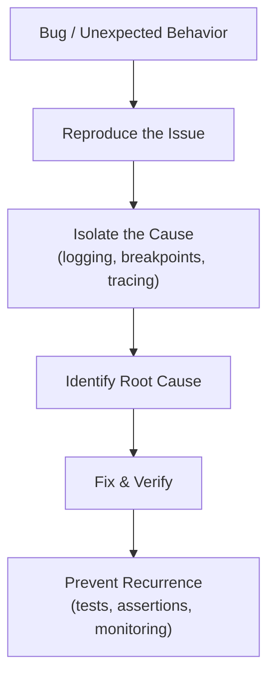
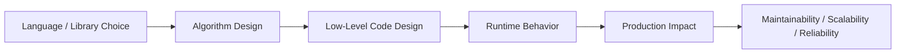

# Debugging Techniques in Python

## Overview

Debugging is the systematic process of identifying, isolating, and fixing defects in software. In Python, debugging ranges from simple `print()` statements to interactive debuggers, structured logging, profiling, and production observability tools.

A Python architect who masters debugging techniques can diagnose issues faster, reduce mean time to resolution (MTTR), and build systems that are inherently easier to debug through good design.

---

## Conceptual Flow





---

## Debugging Toolkit Overview

| Tool | Use Case | Level |
|---|---|---|
| `print()` | Quick inspection | Beginner |
| `assert` | Invariant checking | Beginner |
| `pdb` / `ipdb` | Interactive step-through debugging | Intermediate |
| `breakpoint()` | Built-in debugger entry (Python 3.7+) | Intermediate |
| `logging` | Structured, persistent debug output | Intermediate |
| `traceback` | Exception inspection | Intermediate |
| `faulthandler` | Crash/deadlock diagnosis | Advanced |
| `cProfile` / `line_profiler` | Performance profiling | Advanced |
| `py-spy` | Live process profiling | Advanced |
| `objgraph` | Memory leak detection | Advanced |
| `icecream` (`ic`) | Enhanced print debugging | Intermediate |
| IDE debuggers (VS Code, PyCharm) | Visual step-through | All levels |

---

## Simple Example

### `breakpoint()` and `pdb` Basics

```python
def calculate_discount(price: float, discount_pct: float) -> float:
    """Apply a percentage discount to a price."""
    breakpoint()   # Execution pauses here; opens pdb interactive debugger
    discount = price * (discount_pct / 100)
    final_price = price - discount
    return final_price


result = calculate_discount(100.0, 15)
print(f"Final price: {result}")
```

**pdb Commands:**
```
(Pdb) n          # next line
(Pdb) s          # step into function
(Pdb) c          # continue execution
(Pdb) p price    # print variable
(Pdb) pp vars()  # pretty-print all local variables
(Pdb) l          # list source code around current line
(Pdb) w          # print call stack (where)
(Pdb) q          # quit debugger
(Pdb) b 8        # set breakpoint at line 8
(Pdb) h          # help
```

**Explanation:**
- `breakpoint()` (Python 3.7+) is equivalent to `import pdb; pdb.set_trace()`.
- The `PYTHONBREAKPOINT` environment variable controls which debugger is used (`PYTHONBREAKPOINT=0` disables all breakpoints).
- `ipdb` (`pip install ipdb`) provides a richer pdb experience with syntax highlighting and tab completion.

**Expected Output (interactive):**
```
> /path/to/script.py(4)calculate_discount()
-> discount = price * (discount_pct / 100)
(Pdb) p price
100.0
(Pdb) c
Final price: 85.0
```

---

## Intermediate Example

### Structured Logging for Debugging

```python
import logging
import sys
from typing import Any


# --- Configure structured logging ---
def setup_logging(level: int = logging.DEBUG) -> logging.Logger:
    logger = logging.getLogger("app")
    logger.setLevel(level)

    handler = logging.StreamHandler(sys.stdout)
    handler.setLevel(level)

    formatter = logging.Formatter(
        fmt="%(asctime)s | %(levelname)-8s | %(name)s:%(lineno)d | %(message)s",
        datefmt="%Y-%m-%d %H:%M:%S",
    )
    handler.setFormatter(formatter)
    logger.addHandler(handler)
    return logger


logger = setup_logging()


# --- Application code with debug logging ---
def process_document(doc_id: str, content: str) -> dict[str, Any]:
    logger.debug(f"Processing document: doc_id={doc_id}, content_length={len(content)}")

    if not content.strip():
        logger.warning(f"Empty content for doc_id={doc_id}")
        return {"doc_id": doc_id, "status": "skipped", "reason": "empty"}

    tokens = content.lower().split()
    logger.debug(f"Tokenized: {len(tokens)} tokens")

    word_freq: dict[str, int] = {}
    for token in tokens:
        word_freq[token] = word_freq.get(token, 0) + 1

    top_words = sorted(word_freq.items(), key=lambda x: x[1], reverse=True)[:5]
    logger.info(f"Processed doc_id={doc_id}: {len(tokens)} tokens, top={top_words[:2]}")

    return {"doc_id": doc_id, "status": "ok", "token_count": len(tokens), "top_words": top_words}


# --- Test cases ---
docs = [
    ("doc_001", "The quick brown fox jumps over the lazy dog the fox"),
    ("doc_002", ""),
    ("doc_003", "Python is great Python is powerful Python is fun"),
]

for doc_id, content in docs:
    result = process_document(doc_id, content)
    print(f"Result: {result}\n")
```

**Explanation:**
- Structured log format includes timestamp, level, module, line number, and message.
- `DEBUG` level logs are verbose — useful during development, disabled in production.
- `WARNING` flags unexpected but non-fatal conditions.
- `INFO` records normal operational events.
- Log levels can be controlled per module without changing code.

**Expected Output:**
```
2024-01-01 12:00:00 | DEBUG    | app:25 | Processing document: doc_id=doc_001, ...
2024-01-01 12:00:00 | DEBUG    | app:31 | Tokenized: 11 tokens
2024-01-01 12:00:00 | INFO     | app:37 | Processed doc_id=doc_001: 11 tokens, ...
...
```

---

## Advanced / Architect-Level Example

### Production Observability: Structured Logging + Exception Tracing + Context

**Problem Context:**
A RAG pipeline processes thousands of documents. When failures occur in production, you need rich context (request ID, user ID, document ID, stack trace) to diagnose issues without reproducing them locally.

```python
from __future__ import annotations
import logging
import traceback
import uuid
import sys
from contextlib import contextmanager
from typing import Generator, Any
import json


# --- JSON structured logger for production ---
class JSONFormatter(logging.Formatter):
    def format(self, record: logging.LogRecord) -> str:
        log_data = {
            "timestamp": self.formatTime(record, self.datefmt),
            "level": record.levelname,
            "logger": record.name,
            "message": record.getMessage(),
            "module": record.module,
            "line": record.lineno,
        }
        # Include extra context fields
        for key in ("request_id", "user_id", "doc_id", "operation"):
            if hasattr(record, key):
                log_data[key] = getattr(record, key)
        # Include exception info
        if record.exc_info:
            log_data["exception"] = self.formatException(record.exc_info)
        return json.dumps(log_data)


def setup_json_logger(name: str) -> logging.Logger:
    logger = logging.getLogger(name)
    logger.setLevel(logging.DEBUG)
    handler = logging.StreamHandler(sys.stdout)
    handler.setFormatter(JSONFormatter())
    logger.addHandler(handler)
    return logger


logger = setup_json_logger("rag.pipeline")


# --- Context manager for request-scoped logging ---
@contextmanager
def request_context(
    request_id: str | None = None,
    user_id: str | None = None,
) -> Generator[dict[str, str], None, None]:
    ctx = {
        "request_id": request_id or str(uuid.uuid4())[:8],
        "user_id": user_id or "anonymous",
    }
    yield ctx


# --- Logging adapter for context injection ---
class ContextLogger:
    def __init__(self, logger: logging.Logger, context: dict[str, Any]) -> None:
        self._logger = logger
        self._context = context

    def _log(self, level: int, msg: str, **kwargs: Any) -> None:
        extra = {**self._context, **kwargs}
        self._logger.log(level, msg, extra=extra, exc_info=kwargs.get("exc_info"))

    def debug(self, msg: str, **kwargs: Any) -> None:
        self._log(logging.DEBUG, msg, **kwargs)

    def info(self, msg: str, **kwargs: Any) -> None:
        self._log(logging.INFO, msg, **kwargs)

    def warning(self, msg: str, **kwargs: Any) -> None:
        self._log(logging.WARNING, msg, **kwargs)

    def error(self, msg: str, **kwargs: Any) -> None:
        self._log(logging.ERROR, msg, **kwargs)


# --- Application code ---
def embed_document(doc_id: str, content: str, log: ContextLogger) -> list[float]:
    log.debug("Starting embedding", doc_id=doc_id, operation="embed")
    if not content:
        raise ValueError(f"Empty content for doc_id={doc_id}")
    # Simulate embedding
    return [float(ord(c)) / 255.0 for c in content[:8]]


def process_request(query: str, doc_ids: list[str], user_id: str) -> dict:
    with request_context(user_id=user_id) as ctx:
        log = ContextLogger(logger, ctx)
        log.info(f"Processing query: '{query}'", operation="query")

        results = []
        for doc_id in doc_ids:
            try:
                content = f"Content of {doc_id}" if doc_id != "bad_doc" else ""
                embedding = embed_document(doc_id, content, log)
                results.append({"doc_id": doc_id, "embedding": embedding[:3]})
                log.info(f"Embedded {doc_id}", doc_id=doc_id, operation="embed")
            except ValueError as exc:
                log.error(f"Failed to embed {doc_id}: {exc}", doc_id=doc_id, exc_info=True)

        log.info(f"Completed: {len(results)}/{len(doc_ids)} documents embedded")
        return {"query": query, "results": results}


# --- Run ---
result = process_request(
    query="What is RAG?",
    doc_ids=["doc_001", "bad_doc", "doc_003"],
    user_id="user_42",
)
```

**Explanation:**
- JSON-formatted logs are machine-parseable by log aggregators (Datadog, ELK, CloudWatch).
- `request_id` and `user_id` are injected into every log line for correlation.
- `exc_info=True` includes the full stack trace in the log record.
- `ContextLogger` wraps the standard logger with automatic context injection.

**Design Trade-offs:**
| Approach | Pros | Cons |
|---|---|---|
| `print()` | Zero setup | No levels, no structure, not production-safe |
| `logging` module | Built-in, flexible, leveled | Verbose configuration |
| `structlog` | Structured, context-aware, pipelines | External dependency |
| `loguru` | Simple API, colors, rotation | External dependency |
| OpenTelemetry | Distributed tracing + logs + metrics | Complex setup |

---

## Common Mistakes

### 1. Using `print()` in Production Code
- **Problem:** `print()` has no levels, no timestamps, no context, and cannot be disabled without code changes.
- **Better Approach:** Use `logging` with appropriate levels. Use `print()` only for CLI output.

### 2. Catching All Exceptions Silently
- **Problem:** `except Exception: pass` hides bugs and makes debugging impossible.
- **Better Approach:** Always log the exception with `exc_info=True` or re-raise it.

```python
# Dangerous
try:
    process()
except Exception:
    pass

# Better
try:
    process()
except Exception:
    logger.exception("process() failed")   # Logs with full traceback
    raise
```

### 3. Not Using `breakpoint()` Effectively
- **Problem:** Developers add/remove `print()` statements instead of using the interactive debugger.
- **Better Approach:** Use `breakpoint()` to inspect state interactively; remove before committing.

### 4. Logging Sensitive Data
- **Problem:** Logging passwords, API keys, PII, or tokens creates security vulnerabilities.
- **Better Approach:** Sanitize log data; use log filters to redact sensitive fields.

### 5. Not Correlating Logs Across Services
- **Problem:** In distributed systems, logs from different services are disconnected, making it impossible to trace a request end-to-end.
- **Better Approach:** Propagate a `request_id` / `trace_id` through all service calls and include it in every log line.

### 6. Ignoring Warnings
- **Problem:** Python `DeprecationWarning` and `RuntimeWarning` often precede bugs. Ignoring them leads to surprises.
- **Better Approach:** Run with `python -W error` in tests to treat warnings as errors.

---

## Best Practices

- **Use `logging` not `print()`** for all application output.
- **Set log levels appropriately:** `DEBUG` for development, `INFO` for production, `WARNING`/`ERROR` for issues.
- **Use structured logging** (JSON) in production for machine-parseable logs.
- **Include context** (request ID, user ID, operation) in every log line.
- **Use `logger.exception()`** inside `except` blocks — it automatically includes the stack trace.
- **Use `breakpoint()`** for interactive debugging; remove before committing.
- **Write tests that reproduce bugs** before fixing them — prevents regression.
- **Use `assert` for invariants** in development; disable with `python -O` in production if needed.
- **Profile before optimizing** — use `cProfile` or `py-spy` to find actual bottlenecks.
- **Use `faulthandler`** to diagnose crashes and deadlocks in production.

---

## Performance Considerations

Debugging itself has minimal performance impact when done correctly:

- **`logging` overhead:** Logging at a level below the configured threshold is nearly free (the message is not formatted). Use `logger.isEnabledFor(logging.DEBUG)` before expensive log message construction.
- **`assert` statements:** Disabled with `python -O` (optimize flag). Don't use `assert` for production validation.
- **`pdb` in production:** Never leave `breakpoint()` or `pdb.set_trace()` in production code — it will hang the process waiting for input.
- **Profiling overhead:** `cProfile` adds ~10–30% overhead. Use `py-spy` for zero-overhead sampling profiling of live processes.

```python
# Avoid expensive string formatting when debug is disabled
if logger.isEnabledFor(logging.DEBUG):
    logger.debug(f"Large object: {expensive_repr(obj)}")
```

---

## Testing Strategy

```python
import logging
import pytest


# --- Code under test ---
def divide(a: float, b: float) -> float:
    if b == 0:
        raise ZeroDivisionError("Cannot divide by zero")
    return a / b


def safe_divide(a: float, b: float, logger: logging.Logger) -> float | None:
    try:
        result = divide(a, b)
        logger.info(f"divide({a}, {b}) = {result}")
        return result
    except ZeroDivisionError:
        logger.error(f"Division by zero: divide({a}, {b})", exc_info=True)
        return None


# --- Tests ---

def test_divide_normal():
    assert divide(10, 2) == 5.0


def test_divide_by_zero_raises():
    with pytest.raises(ZeroDivisionError, match="Cannot divide by zero"):
        divide(10, 0)


def test_safe_divide_logs_error(caplog):
    """Test that errors are logged correctly."""
    logger = logging.getLogger("test")
    with caplog.at_level(logging.ERROR, logger="test"):
        result = safe_divide(10, 0, logger)

    assert result is None
    assert "Division by zero" in caplog.text
    assert "ZeroDivisionError" in caplog.text


def test_safe_divide_logs_info(caplog):
    logger = logging.getLogger("test")
    with caplog.at_level(logging.INFO, logger="test"):
        result = safe_divide(10, 2, logger)

    assert result == 5.0
    assert "divide(10, 2) = 5.0" in caplog.text
```

---

## Debugging Tips

- **`python -m pdb script.py`:** Run a script under pdb from the start.
- **Post-mortem debugging:** `import pdb; pdb.pm()` after an exception to inspect the crash state.
- **`traceback.print_exc()`:** Print the current exception's traceback without re-raising.
- **`sys.last_traceback`:** Access the last unhandled exception's traceback in the REPL.
- **`icecream` (`ic`):** `from icecream import ic; ic(variable)` — prints variable name and value with context.
- **`objgraph.show_most_common_types()`:** Identify memory leaks by showing the most common object types.
- **`faulthandler.enable()`:** Dumps Python stack traces on segfaults and `SIGABRT`.
- **`PYTHONASYNCIODEBUG=1`:** Enables asyncio debug mode — detects slow callbacks and unawaited coroutines.
- **`py-spy top`:** Live CPU profiler — shows which functions are consuming the most CPU in a running process.

```python
# Post-mortem debugging
try:
    risky_operation()
except Exception:
    import pdb
    pdb.post_mortem()
```

---

## Interview Questions

### Beginner
1. **What is `breakpoint()` in Python?**
   A built-in function (Python 3.7+) that pauses execution and opens the `pdb` interactive debugger. Equivalent to `import pdb; pdb.set_trace()`.

2. **What is the difference between `logging.debug()` and `print()`?**
   `logging.debug()` supports log levels, timestamps, module names, and can be disabled without code changes. `print()` always outputs and has no metadata.

3. **What does `logger.exception()` do?**
   It logs an ERROR message and automatically includes the current exception's stack trace.

4. **What is `assert` used for in debugging?**
   It checks that a condition is true and raises `AssertionError` if not. Used to verify invariants during development.

5. **How do you view a full stack trace in Python?**
   Use `traceback.print_exc()` inside an `except` block, or let the exception propagate to the top level.

### Intermediate
1. **What is the difference between `pdb.set_trace()` and `pdb.post_mortem()`?**
   `set_trace()` pauses execution at a specific line. `post_mortem()` opens the debugger after an exception has occurred, allowing inspection of the crash state.

2. **How do you configure different log levels for different modules?**
   Use `logging.getLogger("module_name").setLevel(logging.WARNING)` to set per-module levels independently.

3. **What is `caplog` in pytest?**
   A pytest fixture that captures log records during a test, allowing assertions on log output.

4. **How do you profile a Python script to find performance bottlenecks?**
   Use `python -m cProfile -s cumulative script.py` for function-level profiling, or `line_profiler` for line-level profiling.

5. **What is `faulthandler` used for?**
   It dumps Python stack traces on fatal signals (segfault, `SIGABRT`) and can dump all thread stacks after a timeout — useful for diagnosing crashes and deadlocks.

### Advanced / Architect-Level
1. **How would you implement distributed tracing for a multi-service RAG pipeline?**
   Use OpenTelemetry to instrument each service, propagate trace context via HTTP headers (`traceparent`), and export spans to Jaeger or Zipkin. Correlate logs with trace IDs for end-to-end visibility.

2. **How do you debug a memory leak in a long-running Python service?**
   Use `objgraph` to identify growing object types, `tracemalloc` to trace memory allocations, and `memory_profiler` for line-level memory usage. Check for circular references and unclosed resources.

3. **What is the difference between sampling and instrumentation profiling?**
   Instrumentation profiling (cProfile) records every function call — accurate but adds overhead. Sampling profiling (py-spy) periodically samples the call stack — low overhead, suitable for production.

4. **How do you design a system that is easy to debug in production?**
   Use structured JSON logging with request IDs, implement health check endpoints, expose metrics (Prometheus), use distributed tracing (OpenTelemetry), design for idempotency, and write comprehensive tests.

5. **How do you debug an asyncio deadlock or hang?**
   Enable `PYTHONASYNCIODEBUG=1`, use `asyncio.all_tasks()` to list running tasks, use `faulthandler.dump_traceback_later(timeout=10)` to dump stacks on hang, and use `aiomonitor` for live inspection.

---

## Key Takeaways

- Debugging is a skill that improves with practice and the right tools.
- `breakpoint()` and `pdb` are powerful for interactive debugging — learn the commands.
- Structured logging with context (request ID, user ID) is essential for production debugging.
- `logger.exception()` is the correct way to log exceptions — it includes the full stack trace.
- Never silence exceptions with bare `except: pass` — always log or re-raise.
- `faulthandler` and `py-spy` are invaluable for diagnosing crashes and performance issues in production.
- The best debugging tool is a well-written test that reproduces the bug.

---

## Mini Project Idea

### Debug Dashboard for a Document Processing Pipeline

**Goal:** Build a document processing pipeline with comprehensive debugging and observability built in.

**Features:**
- Process documents through multiple stages (parse, tokenize, embed, store).
- Log each stage with structured JSON logging (request ID, stage, duration, status).
- Use `breakpoint()` hooks that can be enabled via environment variable.
- Expose a `/debug/tasks` endpoint showing active tasks and their states.
- Integrate `tracemalloc` to track memory usage per stage.
- Write pytest tests using `caplog` to verify logging behavior.

**Suggested Folder Structure:**
```
debug_pipeline/
├── pipeline/
│   ├── __init__.py
│   ├── stages.py          # Processing stages (parse, tokenize, embed)
│   ├── logging_config.py  # JSON logger setup
│   ├── context.py         # Request context manager
│   └── api.py             # FastAPI debug endpoints
├── tests/
│   ├── test_stages.py
│   └── test_logging.py
├── requirements.txt
└── README.md
```

**Extension Ideas:**
- Add OpenTelemetry tracing to each pipeline stage.
- Implement a `--debug` CLI flag that enables verbose logging and breakpoints.
- Add a memory profiling report generated after each pipeline run.
- Integrate with Sentry for automatic error reporting.

---

## Final Summary

Debugging is not just about fixing bugs — it is about building systems that are transparent, observable, and easy to reason about. A Python architect who masters debugging techniques — from `pdb` and structured logging to distributed tracing and memory profiling — can diagnose issues faster, reduce production incidents, and design systems that surface problems clearly. The most powerful debugging tool is not a specific library but a disciplined approach: reproduce the issue, isolate the cause, understand the root, fix it, and prevent recurrence through tests and monitoring. Mastering debugging transforms you from a developer who reacts to bugs into an architect who designs systems that rarely have them.
