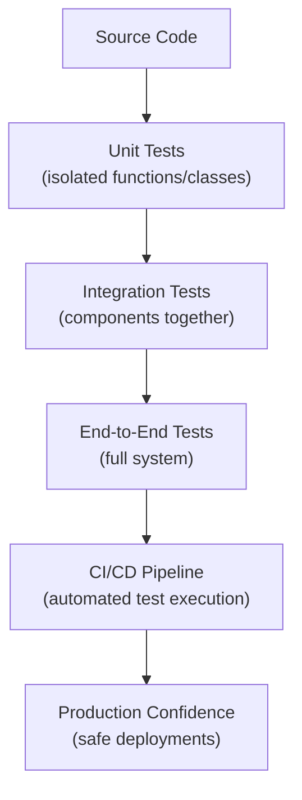
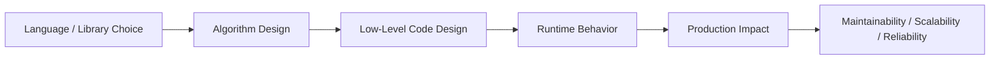

# Testing Frameworks (pytest, unittest) in Python

## Overview

Testing is the practice of verifying that software behaves as expected. Python's testing ecosystem is mature and powerful: `unittest` is the built-in framework, while `pytest` is the de facto standard for production Python projects due to its expressive syntax, rich plugin ecosystem, and powerful fixtures.

A Python architect who masters testing frameworks can build systems with high confidence, enable safe refactoring, and establish quality gates that prevent regressions in production.

---

## Conceptual Flow





---

## pytest vs unittest

| Feature | `pytest` | `unittest` |
|---|---|---|
| Test discovery | Automatic (`test_*.py`) | Requires `TestCase` subclass |
| Assertions | Plain `assert` | `assertEqual`, `assertRaises`, etc. |
| Fixtures | Powerful, composable | `setUp`/`tearDown` only |
| Parametrize | `@pytest.mark.parametrize` | Manual loops |
| Plugins | 1000+ plugins | Limited |
| Output | Rich, colored | Basic |
| Async support | `pytest-asyncio` | `IsolatedAsyncioTestCase` |
| Recommended for | New projects, production | Legacy code, stdlib-only |

---

## Simple Example

### pytest Basics

```python
# math_utils.py
def add(a: float, b: float) -> float:
    return a + b

def divide(a: float, b: float) -> float:
    if b == 0:
        raise ZeroDivisionError("Cannot divide by zero")
    return a / b

def is_palindrome(s: str) -> bool:
    cleaned = s.lower().replace(" ", "")
    return cleaned == cleaned[::-1]
```

```python
# test_math_utils.py
import pytest
from math_utils import add, divide, is_palindrome


# --- Basic assertions ---
def test_add_positive_numbers():
    assert add(2, 3) == 5

def test_add_negative_numbers():
    assert add(-1, -2) == -3

def test_add_floats():
    assert add(0.1, 0.2) == pytest.approx(0.3)   # Floating-point safe comparison


# --- Exception testing ---
def test_divide_by_zero_raises():
    with pytest.raises(ZeroDivisionError, match="Cannot divide by zero"):
        divide(10, 0)

def test_divide_normal():
    assert divide(10, 2) == 5.0


# --- Parametrize ---
@pytest.mark.parametrize("text, expected", [
    ("racecar", True),
    ("hello", False),
    ("A man a plan a canal Panama", True),
    ("", True),
])
def test_is_palindrome(text: str, expected: bool):
    assert is_palindrome(text) == expected
```

**Explanation:**
- `assert` is used directly — pytest rewrites assertions to provide detailed failure messages.
- `pytest.approx()` handles floating-point comparisons safely.
- `pytest.raises()` verifies that the correct exception is raised.
- `@pytest.mark.parametrize` runs the same test with multiple inputs — eliminates test duplication.

**Run:**
```bash
pytest test_math_utils.py -v
```

**Expected Output:**
```
test_math_utils.py::test_add_positive_numbers PASSED
test_math_utils.py::test_add_negative_numbers PASSED
test_math_utils.py::test_add_floats PASSED
test_math_utils.py::test_divide_by_zero_raises PASSED
test_math_utils.py::test_divide_normal PASSED
test_math_utils.py::test_is_palindrome[racecar-True] PASSED
test_math_utils.py::test_is_palindrome[hello-False] PASSED
...
```

---

## Intermediate Example

### Fixtures, Mocking, and Integration Tests

```python
# document_service.py
from dataclasses import dataclass
from typing import Protocol


@dataclass
class Document:
    doc_id: str
    content: str
    embedding: list[float] | None = None


class EmbeddingService(Protocol):
    def embed(self, text: str) -> list[float]: ...


class DocumentRepository(Protocol):
    def save(self, doc: Document) -> None: ...
    def get(self, doc_id: str) -> Document | None: ...


class DocumentService:
    def __init__(self, embedder: EmbeddingService, repo: DocumentRepository) -> None:
        self._embedder = embedder
        self._repo = repo

    def ingest(self, doc_id: str, content: str) -> Document:
        if not content.strip():
            raise ValueError(f"Empty content for doc_id={doc_id}")
        embedding = self._embedder.embed(content)
        doc = Document(doc_id=doc_id, content=content, embedding=embedding)
        self._repo.save(doc)
        return doc

    def retrieve(self, doc_id: str) -> Document:
        doc = self._repo.get(doc_id)
        if doc is None:
            raise KeyError(f"Document not found: {doc_id}")
        return doc
```

```python
# test_document_service.py
import pytest
from unittest.mock import MagicMock, patch
from document_service import Document, DocumentService


# --- Fixtures ---
@pytest.fixture
def mock_embedder():
    embedder = MagicMock()
    embedder.embed.return_value = [0.1, 0.2, 0.3]
    return embedder


@pytest.fixture
def mock_repo():
    repo = MagicMock()
    repo.get.return_value = None   # Default: document not found
    return repo


@pytest.fixture
def service(mock_embedder, mock_repo):
    return DocumentService(embedder=mock_embedder, repo=mock_repo)


# --- Tests ---
def test_ingest_creates_document(service, mock_embedder, mock_repo):
    doc = service.ingest("doc_001", "Hello world")

    assert doc.doc_id == "doc_001"
    assert doc.content == "Hello world"
    assert doc.embedding == [0.1, 0.2, 0.3]

    mock_embedder.embed.assert_called_once_with("Hello world")
    mock_repo.save.assert_called_once_with(doc)


def test_ingest_empty_content_raises(service):
    with pytest.raises(ValueError, match="Empty content"):
        service.ingest("doc_002", "   ")


def test_retrieve_existing_document(service, mock_repo):
    stored_doc = Document("doc_001", "Hello world", [0.1, 0.2, 0.3])
    mock_repo.get.return_value = stored_doc

    result = service.retrieve("doc_001")
    assert result == stored_doc
    mock_repo.get.assert_called_once_with("doc_001")


def test_retrieve_missing_document_raises(service, mock_repo):
    mock_repo.get.return_value = None
    with pytest.raises(KeyError, match="Document not found"):
        service.retrieve("nonexistent")


@pytest.mark.parametrize("content", [
    "Short text",
    "A" * 10_000,   # Very long content
    "Unicode: 日本語テスト",
    "Special chars: !@#$%^&*()",
])
def test_ingest_various_content(service, content):
    doc = service.ingest("doc_x", content)
    assert doc.content == content
    assert doc.embedding is not None
```

**Explanation:**
- `@pytest.fixture` defines reusable setup code — injected by name into test functions.
- `MagicMock()` creates mock objects that record calls and return configured values.
- `assert_called_once_with()` verifies the mock was called with the expected arguments.
- Fixtures compose — `service` depends on `mock_embedder` and `mock_repo`.

---

## Advanced / Architect-Level Example

### Testing a RAG Pipeline: Integration Tests with Dependency Injection

**Problem Context:**
A production RAG pipeline has multiple components (retriever, embedder, LLM, cache). Testing requires: unit tests for each component, integration tests for the pipeline, and contract tests for external APIs.

```python
# rag_pipeline.py
from __future__ import annotations
import asyncio
from dataclasses import dataclass
from typing import List, Protocol


@dataclass
class QueryResult:
    query: str
    documents: List[str]
    answer: str
    cached: bool = False


class AsyncRetriever(Protocol):
    async def retrieve(self, query: str, top_k: int) -> List[str]: ...

class AsyncLLM(Protocol):
    async def generate(self, prompt: str) -> str: ...

class Cache(Protocol):
    def get(self, key: str) -> QueryResult | None: ...
    def set(self, key: str, value: QueryResult) -> None: ...


class RAGPipeline:
    def __init__(
        self,
        retriever: AsyncRetriever,
        llm: AsyncLLM,
        cache: Cache,
    ) -> None:
        self._retriever = retriever
        self._llm = llm
        self._cache = cache

    async def query(self, question: str, top_k: int = 3) -> QueryResult:
        # Check cache first
        cached = self._cache.get(question)
        if cached:
            return QueryResult(**{**cached.__dict__, "cached": True})

        # Retrieve documents
        docs = await self._retriever.retrieve(question, top_k)
        if not docs:
            return QueryResult(query=question, documents=[], answer="No relevant documents found.")

        # Generate answer
        context = "\n".join(docs)
        prompt = f"Context:\n{context}\n\nQuestion: {question}\nAnswer:"
        answer = await self._llm.generate(prompt)

        result = QueryResult(query=question, documents=docs, answer=answer)
        self._cache.set(question, result)
        return result
```

```python
# test_rag_pipeline.py
import pytest
import asyncio
from unittest.mock import AsyncMock, MagicMock
from rag_pipeline import RAGPipeline, QueryResult


# --- Async fixtures ---
@pytest.fixture
def mock_retriever():
    retriever = AsyncMock()
    retriever.retrieve.return_value = [
        "RAG combines retrieval with generation.",
        "Vector databases store embeddings for fast retrieval.",
    ]
    return retriever


@pytest.fixture
def mock_llm():
    llm = AsyncMock()
    llm.generate.return_value = "RAG is a technique that retrieves relevant documents before generating answers."
    return llm


@pytest.fixture
def mock_cache():
    cache = MagicMock()
    cache.get.return_value = None   # Cache miss by default
    return cache


@pytest.fixture
def pipeline(mock_retriever, mock_llm, mock_cache):
    return RAGPipeline(retriever=mock_retriever, llm=mock_llm, cache=mock_cache)


# --- Tests ---
@pytest.mark.asyncio
async def test_query_returns_answer(pipeline, mock_retriever, mock_llm):
    result = await pipeline.query("What is RAG?")

    assert result.query == "What is RAG?"
    assert len(result.documents) == 2
    assert "RAG" in result.answer
    assert result.cached is False

    mock_retriever.retrieve.assert_awaited_once_with("What is RAG?", 3)
    mock_llm.generate.assert_awaited_once()


@pytest.mark.asyncio
async def test_query_uses_cache(pipeline, mock_cache, mock_retriever):
    cached_result = QueryResult(
        query="What is RAG?",
        documents=["cached doc"],
        answer="Cached answer",
    )
    mock_cache.get.return_value = cached_result

    result = await pipeline.query("What is RAG?")

    assert result.cached is True
    assert result.answer == "Cached answer"
    mock_retriever.retrieve.assert_not_awaited()   # Should not call retriever


@pytest.mark.asyncio
async def test_query_no_documents(pipeline, mock_retriever):
    mock_retriever.retrieve.return_value = []

    result = await pipeline.query("Unknown topic")

    assert result.answer == "No relevant documents found."
    assert result.documents == []


@pytest.mark.asyncio
async def test_query_stores_result_in_cache(pipeline, mock_cache):
    await pipeline.query("What is RAG?")
    mock_cache.set.assert_called_once()


@pytest.mark.asyncio
async def test_concurrent_queries(pipeline):
    """Test that multiple concurrent queries work correctly."""
    results = await asyncio.gather(
        pipeline.query("Query 1"),
        pipeline.query("Query 2"),
        pipeline.query("Query 3"),
    )
    assert len(results) == 3
    assert all(r.answer for r in results)


# --- Property-based test with Hypothesis ---
# pip install hypothesis
from hypothesis import given, strategies as st

@given(st.text(min_size=1, max_size=200))
def test_query_never_raises_on_valid_input(question):
    """Property: pipeline never raises for any non-empty question."""
    import asyncio
    from unittest.mock import AsyncMock, MagicMock

    retriever = AsyncMock()
    retriever.retrieve.return_value = ["doc"]
    llm = AsyncMock()
    llm.generate.return_value = "answer"
    cache = MagicMock()
    cache.get.return_value = None

    p = RAGPipeline(retriever=retriever, llm=llm, cache=cache)
    # Should not raise
    asyncio.run(p.query(question))
```

**Explanation:**
- `AsyncMock` is used for async dependencies — it supports `assert_awaited_once_with()`.
- `@pytest.mark.asyncio` enables async test functions (requires `pytest-asyncio`).
- Fixtures compose cleanly — `pipeline` depends on three other fixtures.
- Property-based testing with `Hypothesis` generates hundreds of random inputs automatically.
- Tests verify behavior (cache hit/miss, empty results) not just happy paths.

**Design Trade-offs:**
| Approach | Pros | Cons |
|---|---|---|
| Unit tests with mocks | Fast, isolated, precise | May miss integration bugs |
| Integration tests | Catches real interactions | Slower, requires infrastructure |
| Contract tests (Pact) | Verifies API contracts | Complex setup |
| E2E tests | Full system confidence | Slow, brittle, expensive |
| Property-based (Hypothesis) | Finds edge cases automatically | Requires careful property design |

---

## Common Mistakes

### 1. Testing Implementation, Not Behavior
- **Problem:** Tests that assert internal state or call order break on refactoring.
- **Better Approach:** Test observable behavior (return values, side effects, exceptions).

### 2. Not Using Fixtures for Setup
- **Problem:** Duplicating setup code across tests makes maintenance painful.
- **Better Approach:** Extract shared setup into `@pytest.fixture` functions.

### 3. Over-Mocking
- **Problem:** Mocking everything means tests don't catch real integration bugs.
- **Better Approach:** Mock only external dependencies (APIs, DBs); use real implementations for internal components.

### 4. Ignoring Test Isolation
- **Problem:** Tests that share state (global variables, files) can interfere with each other.
- **Better Approach:** Each test should be independent. Use fixtures with `scope="function"` (default) for isolation.

### 5. Not Testing Edge Cases
- **Problem:** Tests only cover the happy path, missing boundary conditions and error cases.
- **Better Approach:** Test empty inputs, None values, maximum sizes, and error conditions explicitly.

### 6. Slow Tests Without Markers
- **Problem:** Slow integration tests run on every commit, slowing CI.
- **Better Approach:** Mark slow tests with `@pytest.mark.slow` and exclude them from fast CI runs.

```python
# Mark slow tests
@pytest.mark.slow
def test_full_pipeline_integration():
    ...

# Run only fast tests
# pytest -m "not slow"
```

### 7. Not Using `pytest.approx` for Floats
- **Problem:** `assert 0.1 + 0.2 == 0.3` fails due to floating-point precision.
- **Better Approach:** Use `assert result == pytest.approx(0.3)`.

---

## Best Practices

- **Follow the AAA pattern:** Arrange (setup), Act (call), Assert (verify).
- **One assertion per test** (ideally) — makes failures easy to diagnose.
- **Use descriptive test names:** `test_ingest_empty_content_raises_value_error` not `test_1`.
- **Use `@pytest.mark.parametrize`** to test multiple inputs without duplicating test code.
- **Use `conftest.py`** for shared fixtures across multiple test files.
- **Use `pytest-cov`** to measure code coverage: `pytest --cov=src --cov-report=html`.
- **Aim for 80%+ coverage** on business logic; 100% on critical paths.
- **Use `@pytest.mark.xfail`** for known bugs that are not yet fixed.
- **Use `tmp_path` fixture** for tests that need temporary files.
- **Run tests in parallel** with `pytest-xdist`: `pytest -n auto`.

---

## Performance Considerations

Testing itself has no production performance impact, but test suite performance matters for developer productivity:

- **Fast unit tests:** Should run in milliseconds. Use mocks to avoid real I/O.
- **Parallel execution:** `pytest-xdist` runs tests in parallel across CPU cores — dramatically speeds up large test suites.
- **Test selection:** Use `-k "keyword"` to run only matching tests during development.
- **`pytest-randomly`:** Randomizes test order to detect order-dependent failures.
- **Database tests:** Use transactions that are rolled back after each test (no cleanup needed).
- **`pytest-benchmark`:** Measures and tracks performance of critical functions over time.

```bash
# Run tests in parallel
pytest -n auto

# Run only tests matching keyword
pytest -k "document"

# Measure coverage
pytest --cov=src --cov-report=term-missing
```

---

## Testing Strategy

```python
# conftest.py — shared fixtures
import pytest
import tempfile
import os


@pytest.fixture(scope="session")
def temp_dir():
    """Session-scoped temporary directory."""
    with tempfile.TemporaryDirectory() as tmpdir:
        yield tmpdir


@pytest.fixture(autouse=True)
def reset_environment(monkeypatch):
    """Reset environment variables before each test."""
    monkeypatch.delenv("API_KEY", raising=False)
    monkeypatch.setenv("ENV", "test")


# test_file_processor.py
import pytest
from pathlib import Path


def read_and_count_words(filepath: str) -> int:
    with open(filepath) as f:
        return len(f.read().split())


def test_word_count(tmp_path):
    """pytest's built-in tmp_path fixture provides a temporary directory."""
    test_file = tmp_path / "test.txt"
    test_file.write_text("The quick brown fox jumps over the lazy dog")

    count = read_and_count_words(str(test_file))
    assert count == 9


def test_empty_file(tmp_path):
    test_file = tmp_path / "empty.txt"
    test_file.write_text("")
    assert read_and_count_words(str(test_file)) == 0


def test_file_not_found():
    with pytest.raises(FileNotFoundError):
        read_and_count_words("/nonexistent/path/file.txt")
```

---

## Debugging Tips

- **`pytest -v`:** Verbose output — shows each test name and result.
- **`pytest -s`:** Disables output capture — shows `print()` statements during tests.
- **`pytest --tb=short`:** Short traceback format — easier to read for many failures.
- **`pytest --lf`:** Run only the last failed tests — fast iteration on failures.
- **`pytest --pdb`:** Drop into `pdb` on test failure — interactive debugging.
- **`pytest -x`:** Stop after the first failure — useful for fixing one issue at a time.
- **`pytest --co`:** Collect and list all tests without running them.
- **`caplog` fixture:** Capture and assert on log output in tests.
- **`monkeypatch` fixture:** Safely patch environment variables, attributes, and functions.

```bash
# Debug a specific failing test
pytest test_rag_pipeline.py::test_query_returns_answer -v -s --pdb

# Run only last failed tests
pytest --lf

# Show slowest 10 tests
pytest --durations=10
```

---

## Interview Questions

### Beginner
1. **What is the difference between `pytest` and `unittest`?**
   `pytest` uses plain `assert` statements, has powerful fixtures, and a rich plugin ecosystem. `unittest` is the built-in framework requiring `TestCase` subclasses and specific assertion methods.

2. **What is a test fixture in pytest?**
   A function decorated with `@pytest.fixture` that provides setup/teardown logic and is injected into test functions by name.

3. **How do you test that a function raises an exception in pytest?**
   Use `with pytest.raises(ExceptionType):` as a context manager around the code that should raise.

4. **What is `@pytest.mark.parametrize`?**
   A decorator that runs the same test function with multiple sets of inputs, reducing test duplication.

5. **What is code coverage and how do you measure it?**
   Code coverage measures the percentage of source code executed by tests. Measure with `pytest --cov=src`.

### Intermediate
1. **What is the difference between `MagicMock` and `AsyncMock`?**
   `MagicMock` mocks synchronous functions. `AsyncMock` mocks async functions — its return value is awaitable.

2. **What is `conftest.py` used for?**
   A special pytest file for defining shared fixtures, hooks, and plugins that are automatically available to all tests in the same directory and subdirectories.

3. **What is the `monkeypatch` fixture?**
   A pytest fixture for safely patching attributes, environment variables, and functions during a test. Changes are automatically reverted after the test.

4. **What is property-based testing?**
   A testing approach where you define properties (invariants) that should hold for all inputs, and a framework (Hypothesis) generates hundreds of random inputs to find counterexamples.

5. **What is the difference between `scope="function"` and `scope="session"` in fixtures?**
   `scope="function"` (default): fixture is created and destroyed for each test. `scope="session"`: fixture is created once for the entire test session — useful for expensive setup (DB connections, model loading).

### Advanced / Architect-Level
1. **How would you design a testing strategy for a RAG pipeline with external dependencies?**
   Unit test each component with mocks, integration test component interactions with test doubles, use contract tests (Pact) for external APIs, and E2E tests for critical user journeys. Use `pytest-asyncio` for async components.

2. **What is test-driven development (TDD) and when is it most valuable?**
   TDD writes tests before implementation (Red-Green-Refactor cycle). Most valuable for well-defined requirements, complex business logic, and API design — it forces clear interfaces and prevents over-engineering.

3. **How do you test database interactions without hitting a real database?**
   Use in-memory databases (SQLite for SQL, `mongomock` for MongoDB), transaction rollback fixtures, or repository pattern with mock implementations.

4. **What is mutation testing and how does it improve test quality?**
   Mutation testing introduces small code changes (mutations) and checks if tests catch them. Tools like `mutmut` identify tests that pass even when the code is broken — revealing weak assertions.

5. **How do you ensure test suite performance doesn't degrade as the codebase grows?**
   Use `pytest-xdist` for parallel execution, mark and exclude slow tests from fast CI runs, use `pytest --durations=10` to identify slow tests, mock expensive I/O, and use session-scoped fixtures for expensive shared resources.

---

## Key Takeaways

- `pytest` is the standard for production Python testing — use it for all new projects.
- Fixtures provide composable, reusable setup/teardown — master them for clean test code.
- `@pytest.mark.parametrize` eliminates test duplication for multiple input scenarios.
- Mock external dependencies (`MagicMock`, `AsyncMock`) to keep unit tests fast and isolated.
- Test behavior, not implementation — tests should survive refactoring.
- Measure coverage with `pytest-cov`; aim for 80%+ on business logic.
- Property-based testing with `Hypothesis` finds edge cases that manual tests miss.
- A comprehensive test suite is the foundation of confident, continuous deployment.

---

## Mini Project Idea

### Test Suite for a Document Ingestion Pipeline

**Goal:** Build a comprehensive test suite for a multi-stage document ingestion pipeline (parse → embed → store → retrieve).

**Features:**
- Unit tests for each pipeline stage with mocks.
- Integration tests for stage interactions.
- Async tests for async pipeline components using `pytest-asyncio`.
- Parametrized tests for various document types (PDF, HTML, plain text).
- Property-based tests with `Hypothesis` for the text parser.
- Coverage report with `pytest-cov`.
- Performance benchmarks with `pytest-benchmark`.

**Suggested Folder Structure:**
```
doc_pipeline/
├── pipeline/
│   ├── __init__.py
│   ├── parser.py          # Document parsing
│   ├── embedder.py        # Embedding generation
│   ├── store.py           # Document storage
│   └── retriever.py       # Document retrieval
├── tests/
│   ├── conftest.py        # Shared fixtures
│   ├── unit/
│   │   ├── test_parser.py
│   │   ├── test_embedder.py
│   │   └── test_store.py
│   ├── integration/
│   │   └── test_pipeline.py
│   └── property/
│       └── test_parser_properties.py
├── pytest.ini
├── requirements.txt
└── README.md
```

**`pytest.ini`:**
```ini
[pytest]
asyncio_mode = auto
markers =
    slow: marks tests as slow (deselect with '-m "not slow"')
    integration: marks integration tests
addopts = --tb=short -q
```

**Extension Ideas:**
- Add contract tests using `Pact` for the embedding API.
- Implement mutation testing with `mutmut`.
- Add a GitHub Actions CI workflow that runs tests on every PR.
- Generate and publish HTML coverage reports as CI artifacts.

---

## Final Summary

Testing frameworks are the foundation of production-quality Python software. A Python architect who masters `pytest` — fixtures, parametrize, mocking, async testing, and property-based testing — can build systems that are verifiably correct, safely refactorable, and continuously deployable. Testing is not a tax on development; it is an investment that pays dividends in reduced bugs, faster debugging, and the confidence to ship changes at speed. In the context of AI systems and RAG pipelines, where correctness is critical and components are complex, a comprehensive test suite is not optional — it is the difference between a prototype and a production system.
