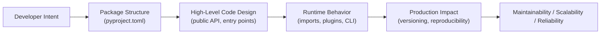
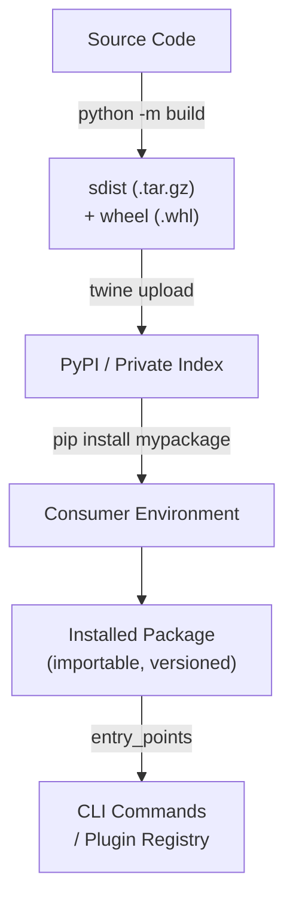

# Packaging and Distribution

## Overview

**Python packaging** is the discipline of structuring, building, and distributing Python code so that it can be installed, versioned, and consumed reliably — by other developers, automated systems, or end users. **Distribution** is the act of publishing that package to a registry (PyPI, a private index, or a container registry) or delivering it as a standalone artifact.

In production-grade systems — AI agents, RAG pipelines, enterprise backends, and internal platform libraries — packaging is not an afterthought. It is the mechanism that enforces API contracts between services, enables semantic versioning, powers plugin architectures, and makes CI/CD pipelines reproducible. A poorly packaged library is a liability; a well-packaged one is an asset that scales across teams.

---

## Why It Matters





---

## Simple Example

### Creating and Installing a Minimal Package

**Project structure:**
```
my_greeter/
├── pyproject.toml
└── src/
    └── my_greeter/
        ├── __init__.py
        └── greet.py
```

```python
# src/my_greeter/greet.py
def hello(name: str) -> str:
    return f"Hello, {name}!"
```

```python
# src/my_greeter/__init__.py
from .greet import hello

__version__ = "0.1.0"
__all__ = ["hello"]
```

```toml
# pyproject.toml
[build-system]
requires = ["hatchling"]
build-backend = "hatchling.build"

[project]
name = "my-greeter"
version = "0.1.0"
description = "A simple greeting library"
requires-python = ">=3.11"
dependencies = []

[project.urls]
Homepage = "https://github.com/example/my-greeter"
```

```bash
# Install in editable mode for development
pip install -e .

# Build distributable artifacts
pip install build
python -m build
# Produces: dist/my_greeter-0.1.0.tar.gz
#           dist/my_greeter-0.1.0-py3-none-any.whl
```

```python
# Usage after installation
from my_greeter import hello
print(hello("World"))
```

**Explanation:**
- `pyproject.toml` is the modern, PEP 517/518-compliant single source of truth for build metadata.
- The `src/` layout prevents accidental imports of the uninstalled source directory.
- `python -m build` produces both a source distribution (`sdist`) and a wheel (`whl`).
- Wheels are pre-built and install faster; sdists are the source fallback.

**Expected output:**
```
Hello, World!
```

---

## Intermediate Example

### A Reusable Internal Library with CLI Entry Point and Optional Dependencies

**Problem:** You are building an internal `datautils` library used by multiple services in your platform. It needs a CLI tool, optional heavy dependencies (pandas), and proper versioning.

```
datautils/
├── pyproject.toml
├── README.md
├── CHANGELOG.md
├── src/
│   └── datautils/
│       ├── __init__.py
│       ├── core.py
│       ├── cli.py
│       └── _version.py
└── tests/
    └── test_core.py
```

```python
# src/datautils/_version.py
__version__ = "1.2.0"
```

```python
# src/datautils/core.py
from __future__ import annotations
from typing import Any

def normalize_keys(data: dict[str, Any]) -> dict[str, Any]:
    """Lowercase and strip all string keys in a dict."""
    return {k.strip().lower(): v for k, v in data.items()}

def flatten(nested: dict, sep: str = ".") -> dict:
    """Flatten a nested dict using dot-notation keys."""
    result = {}
    def _flatten(obj: dict, prefix: str = "") -> None:
        for key, value in obj.items():
            full_key = f"{prefix}{sep}{key}" if prefix else key
            if isinstance(value, dict):
                _flatten(value, full_key)
            else:
                result[full_key] = value
    _flatten(nested)
    return result
```

```python
# src/datautils/cli.py
import argparse
import json
import sys
from datautils.core import flatten

def main() -> None:
    parser = argparse.ArgumentParser(description="datautils CLI")
    parser.add_argument("command", choices=["flatten"])
    parser.add_argument("--input", required=True, help="JSON string to process")
    args = parser.parse_args()

    data = json.loads(args.input)
    if args.command == "flatten":
        print(json.dumps(flatten(data), indent=2))

if __name__ == "__main__":
    main()
```

```toml
# pyproject.toml
[build-system]
requires = ["hatchling"]
build-backend = "hatchling.build"

[project]
name = "datautils"
version = "1.2.0"
description = "Internal data transformation utilities"
readme = "README.md"
requires-python = ">=3.11"
license = { text = "MIT" }
dependencies = [
    "pydantic>=2.0",
]

[project.optional-dependencies]
pandas = ["pandas>=2.0"]
dev = ["pytest>=8.0", "black", "ruff", "build", "twine"]

[project.scripts]
datautils = "datautils.cli:main"

[tool.hatch.build.targets.wheel]
packages = ["src/datautils"]
```

```bash
# Install with optional pandas support
pip install -e ".[pandas]"

# Use the CLI
datautils flatten --input '{"a": {"b": 1, "c": 2}}'
```

**Expected output:**
```json
{
  "a.b": 1,
  "a.c": 2
}
```

**Explanation:**
- `[project.scripts]` registers `datautils` as a shell command pointing to `datautils.cli:main`.
- `[project.optional-dependencies]` lets consumers opt into heavy extras (`pandas`) without forcing them on everyone.
- The `dev` extra groups all development tooling, installable with `pip install -e ".[dev]"`.

---

## Advanced / Architect-Level Example

### Plugin Architecture for an AI Agent Framework Using Entry Points

**Problem context:** You are building `agentcore`, an extensible AI agent framework. Third-party developers should be able to publish their own tool plugins (e.g., `agentcore-web-search`, `agentcore-sql-tool`) that are automatically discovered at runtime — without modifying the core framework. This is the same pattern used by `pytest` plugins, `Flask` extensions, and `Babel` extractors.

```
agentcore/                          # Core framework package
├── pyproject.toml
└── src/
    └── agentcore/
        ├── __init__.py
        ├── registry.py             # Plugin discovery engine
        └── base_tool.py            # Abstract base for all tools

agentcore-web-search/               # Third-party plugin (separate repo/package)
├── pyproject.toml
└── src/
    └── agentcore_web_search/
        ├── __init__.py
        └── tool.py
```

```python
# src/agentcore/base_tool.py
from abc import ABC, abstractmethod
from typing import Any

class BaseTool(ABC):
    name: str
    description: str

    @abstractmethod
    def run(self, input: str) -> Any:
        """Execute the tool with the given input."""
        ...
```

```python
# src/agentcore/registry.py
from importlib.metadata import entry_points
from agentcore.base_tool import BaseTool

class ToolRegistry:
    """Discovers and loads all installed agentcore tool plugins."""

    GROUP = "agentcore.tools"

    def __init__(self) -> None:
        self._tools: dict[str, BaseTool] = {}

    def load_plugins(self) -> None:
        """Auto-discover all installed plugins via entry_points."""
        eps = entry_points(group=self.GROUP)
        for ep in eps:
            tool_class = ep.load()
            instance = tool_class()
            self._tools[instance.name] = instance
            print(f"[registry] Loaded tool: {instance.name}")

    def get(self, name: str) -> BaseTool:
        return self._tools[name]

    def list_tools(self) -> list[str]:
        return list(self._tools.keys())
```

```toml
# agentcore/pyproject.toml
[project]
name = "agentcore"
version = "2.0.0"
dependencies = []
```

```python
# agentcore-web-search/src/agentcore_web_search/tool.py
from agentcore.base_tool import BaseTool

class WebSearchTool(BaseTool):
    name = "web_search"
    description = "Search the web using DuckDuckGo"

    def run(self, input: str) -> str:
        # Real implementation would call an HTTP API
        return f"[web_search] Results for: {input}"
```

```toml
# agentcore-web-search/pyproject.toml
[project]
name = "agentcore-web-search"
version = "1.0.0"
dependencies = ["agentcore>=2.0"]

[project.entry-points."agentcore.tools"]
web_search = "agentcore_web_search.tool:WebSearchTool"
```

```python
# Usage: after pip install agentcore agentcore-web-search
from agentcore.registry import ToolRegistry

registry = ToolRegistry()
registry.load_plugins()

print(registry.list_tools())
result = registry.get("web_search").run("Python packaging best practices")
print(result)
```

**Expected output:**
```
[registry] Loaded tool: web_search
['web_search']
[web_search] Results for: Python packaging best practices
```

**Explanation:**
- `entry_points` (PEP 517 / `importlib.metadata`) is the standard Python plugin discovery mechanism.
- The core framework (`agentcore`) defines the group name `"agentcore.tools"` and the `BaseTool` contract.
- Any installed package that declares an entry point in that group is automatically discovered — zero configuration in the core.
- This is how `pytest` discovers plugins (`pytest11`), how `Flask` discovers extensions, and how `Babel` discovers extractors.

**Design trade-offs:**

| Approach | Pros | Cons |
|---|---|---|
| Entry points (importlib.metadata) | Standard, zero-config discovery | Requires package installation |
| Explicit registration (`registry.register(MyTool)`) | Simple, no install needed | Manual, not scalable |
| File-based discovery (scan a directory) | Works without packaging | Fragile, path-dependent |
| Config-driven (YAML/TOML plugin list) | Explicit, auditable | Requires config management |

---

## Common Mistakes

### 1. Using `setup.py` / `setup.cfg` instead of `pyproject.toml`
- **Problem:** `setup.py` is a Python script that runs arbitrary code at install time, creating security and reproducibility risks. It is deprecated for new projects.
- **Better approach:** Use `pyproject.toml` (PEP 517/518/621). It is declarative, tool-agnostic, and supported by all modern build backends (`hatchling`, `flit`, `poetry-core`, `setuptools`).

### 2. Not using the `src/` layout
- **Problem:** Placing your package directly at the root (e.g., `mypackage/` next to `pyproject.toml`) means Python can import it from the project root without installing it. This masks import errors that would appear in production.
- **Better approach:** Use `src/mypackage/`. This forces you to install the package (`pip install -e .`) before importing it, catching packaging errors early.

### 3. Hardcoding the version in multiple places
- **Problem:** Updating the version requires changing `pyproject.toml`, `__init__.py`, and possibly a `CHANGELOG` — easy to miss one.
- **Better approach:** Use a single source of truth. With `hatchling`, set `version = "dynamic"` and use `hatch-vcs` to derive the version from Git tags. Or read `importlib.metadata.version("mypackage")` in `__init__.py`.

### 4. Publishing to PyPI without a clean build
- **Problem:** Uploading a wheel built from a dirty working tree (uncommitted changes) means the published artifact does not match the tagged commit.
- **Better approach:** Always build from a clean Git state. Use CI (GitHub Actions) to build and publish on tag push. Never run `twine upload` manually from a development machine.

### 5. Forgetting to include non-Python files (data files, templates)
- **Problem:** `MANIFEST.in` or `package_data` is not configured, so JSON schemas, HTML templates, or model configs are missing from the installed package.
- **Better approach:** Use `[tool.hatch.build.targets.wheel] include` or `[tool.setuptools.package-data]` to explicitly include non-Python assets. Verify with `pip show -f mypackage`.

### 6. Using overly broad version constraints
- **Problem:** `dependencies = ["requests"]` (no version pin) means any future breaking version of `requests` can break your package.
- **Better approach:** Use compatible release specifiers: `"requests>=2.28,<3"`. For internal packages, pin exactly: `"mylib==1.2.0"`.

### 7. Uploading to PyPI without a `README` or `CHANGELOG`
- **Problem:** PyPI renders the `README.md` as the package homepage. Missing or broken Markdown makes the package look unmaintained.
- **Better approach:** Set `readme = "README.md"` in `pyproject.toml` and verify rendering with `twine check dist/*` before uploading.

---

## Best Practices

- **Use `pyproject.toml`** as the single source of truth for all project metadata and tooling config.
- **Use the `src/` layout** to enforce proper installation and prevent import path confusion.
- **Use semantic versioning** (`MAJOR.MINOR.PATCH`) and tag releases in Git (`git tag v1.2.0`).
- **Automate publishing** via CI (GitHub Actions `release.yml`) triggered on Git tag push — never publish manually.
- **Use `twine check dist/*`** before uploading to catch metadata and README rendering issues.
- **Use a private index** (Artifactory, AWS CodeArtifact, Gemfury) for internal packages — never publish internal code to public PyPI.
- **Sign releases** with `sigstore` or GPG for supply-chain security.
- **Use `importlib.metadata`** to read version and metadata at runtime instead of hardcoding strings.
- **Test the installed package**, not the source directory, in CI: `pip install dist/*.whl && pytest`.
- **Maintain a `CHANGELOG.md`** following [Keep a Changelog](https://keepachangelog.com/) conventions.

---

## Performance Considerations

Packaging itself has **no runtime performance impact** — it is a build-time and install-time concern. However, several packaging decisions affect runtime and operational performance:

- **Wheel vs. sdist:** Wheels install without compilation, making `pip install` significantly faster in CI and Docker builds. Always publish wheels.
- **C extensions:** If your package wraps C/C++/Rust code (e.g., via `cffi`, `pybind11`, `maturin`), you must publish platform-specific wheels (`manylinux`, `win_amd64`, `macosx`) or consumers will need a compiler. Use `cibuildwheel` to automate multi-platform wheel builds.
- **Package size:** Large packages (bundled models, datasets) slow down `pip install` and bloat Docker images. Use optional dependencies or separate data packages.
- **Import time:** Avoid heavy top-level imports in `__init__.py`. Lazy imports keep `import mypackage` fast, which matters for CLI tools and serverless cold starts.
- **Docker layer caching:** Copy `pyproject.toml` / `requirements.txt` before copying source code so that the dependency layer is cached and only rebuilt when dependencies change.

---

## Testing Strategy

Testing a package involves two levels: testing the **library logic** and testing the **packaging itself**.

### Testing Library Logic

```python
# tests/test_core.py
import pytest
from datautils.core import normalize_keys, flatten

def test_normalize_keys_lowercases():
    result = normalize_keys({"Name": "Alice", " AGE ": 30})
    assert result == {"name": "Alice", "age": 30}

def test_normalize_keys_empty():
    assert normalize_keys({}) == {}

def test_flatten_simple():
    result = flatten({"a": {"b": 1}})
    assert result == {"a.b": 1}

def test_flatten_custom_separator():
    result = flatten({"a": {"b": 1}}, sep="/")
    assert result == {"a/b": 1}

def test_flatten_non_nested():
    result = flatten({"x": 1, "y": 2})
    assert result == {"x": 1, "y": 2}
```

### Testing the Package Metadata

```python
# tests/test_packaging.py
import importlib.metadata
import datautils

def test_version_is_accessible():
    version = importlib.metadata.version("datautils")
    assert version == datautils.__version__

def test_package_has_required_metadata():
    meta = importlib.metadata.metadata("datautils")
    assert meta["Name"] == "datautils"
    assert meta["Requires-Python"] is not None
```

### Testing the CLI Entry Point

```python
# tests/test_cli.py
import subprocess
import sys
import json

def test_cli_flatten():
    result = subprocess.run(
        [sys.executable, "-m", "datautils.cli", "flatten",
         "--input", '{"a": {"b": 1}}'],
        capture_output=True, text=True
    )
    assert result.returncode == 0
    output = json.loads(result.stdout)
    assert output == {"a.b": 1}
```

```bash
# In CI: install the built wheel, then test
pip install dist/*.whl
pytest tests/ -v
```

---

## Debugging Tips

- **`pip show mypackage`** — shows installed version, location, and declared dependencies.
- **`pip show -f mypackage`** — lists every file installed by the package; use this to verify data files are included.
- **`python -c "import mypackage; print(mypackage.__file__)"`** — confirms which installation is being imported.
- **`twine check dist/*`** — validates package metadata and README rendering before upload.
- **`pip install dist/*.whl --force-reinstall`** — test the built wheel locally before publishing.
- **`python -m build --no-isolation`** — build without a clean venv (faster for debugging build issues).
- **`importlib.metadata.files("mypackage")`** — programmatically list all installed files.
- **Missing data files:** Check `[tool.hatch.build.targets.wheel] include` or `MANIFEST.in`. Run `tar tzf dist/*.tar.gz` to inspect sdist contents.
- **Entry point not found:** Run `pip install -e .` after editing `pyproject.toml`. Entry points are registered at install time, not import time.
- **Version mismatch:** Use `importlib.metadata.version("mypackage")` to check the runtime version vs. what you expect.

---

## Interview Questions

### Beginner

1. **What is the difference between a wheel (`.whl`) and a source distribution (`.tar.gz`)?**
   *A wheel is a pre-built binary archive that installs without compilation. A source distribution contains raw source code and requires a build step. Wheels install faster and are preferred.*

2. **What is `pyproject.toml` and why was it introduced?**
   *`pyproject.toml` is the PEP 517/518 standard configuration file for Python projects. It replaced `setup.py` to provide a declarative, tool-agnostic, and secure way to specify build requirements and project metadata.*

3. **What does `pip install -e .` do?**
   *It installs the package in "editable" mode, creating a link to the source directory so that changes to the source are immediately reflected without reinstalling.*

4. **What is PyPI?**
   *The Python Package Index — the official public registry where Python packages are published and from which `pip install` downloads packages by default.*

5. **What is the purpose of `__init__.py` in a package?**
   *It marks a directory as a Python package and can expose the package's public API. It is executed when the package is first imported.*

### Intermediate

1. **What is the `src/` layout and why is it recommended?**
   *Placing the package under `src/mypackage/` prevents Python from importing the package directly from the project root without installation. This catches packaging errors (missing files, wrong paths) that would otherwise only appear in production.*

2. **What are entry points and what are they used for?**
   *Entry points are metadata declared in `pyproject.toml` that map a group name and key to a Python callable. They are used for CLI scripts (`[project.scripts]`) and plugin discovery (`[project.entry-points."myapp.plugins"]`). They are read at runtime via `importlib.metadata.entry_points()`.*

3. **How do you handle version management across `pyproject.toml` and `__init__.py`?**
   *Use a single source of truth: either derive the version dynamically from Git tags using `hatch-vcs` / `setuptools-scm`, or read it at runtime with `importlib.metadata.version("mypackage")` in `__init__.py`.*

4. **What is `twine` and when do you use it?**
   *`twine` is the standard tool for uploading Python packages to PyPI or a private index. It is used after `python -m build` to upload the artifacts in `dist/`. It also provides `twine check` to validate packages before upload.*

5. **What is the difference between `dependencies` and `optional-dependencies` in `pyproject.toml`?**
   *`dependencies` are always installed with the package. `optional-dependencies` (extras) are only installed when explicitly requested (`pip install mypackage[extra]`). Use extras for heavy or optional features like pandas support or CLI tools.*

### Advanced / Architect-Level

1. **How would you design a CI/CD pipeline for publishing a Python package to a private PyPI index?**
   *Use GitHub Actions with a `release.yml` workflow triggered on `push: tags: ['v*']`. Steps: checkout, set up Python, install `build` and `twine`, run `python -m build`, run `twine check dist/*`, run the test suite against the built wheel, then `twine upload --repository-url $PRIVATE_INDEX dist/*` using secrets for credentials.*

2. **Explain the `importlib.metadata` entry points mechanism and how it enables zero-configuration plugin architectures.**
   *When a package is installed, its entry points are written to `dist-info/entry_points.txt`. `importlib.metadata.entry_points(group="myapp.plugins")` reads all installed packages' metadata and returns the matching entry points. The framework calls `ep.load()` to import and instantiate the plugin class. No central registry or config file is needed — installation is the registration act.*

3. **What is `cibuildwheel` and when would you use it?**
   *`cibuildwheel` is a tool that automates building Python wheels for multiple platforms (Linux `manylinux`, macOS, Windows) and Python versions in CI. It is essential when your package contains C/C++/Rust extensions that must be compiled per platform. Without it, users on unsupported platforms would need a compiler to install your package.*

4. **How do you prevent supply-chain attacks when distributing internal Python packages?**
   *Use a private package index (Artifactory, AWS CodeArtifact) with authentication. Pin all dependencies with exact versions and hashes (`pip-compile --generate-hashes`). Sign releases with `sigstore`. Use `pip install --require-hashes` in production. Audit dependencies with `pip-audit`. Never use `--extra-index-url` with public PyPI alongside a private index (dependency confusion attack vector).*

5. **How would you architect a versioning strategy for a platform with 10 internal Python libraries that have interdependencies?**
   *Use a monorepo with `uv` workspaces or `poetry` workspaces so all packages share a single lock file. Apply semantic versioning strictly. Use `hatch-vcs` to derive versions from Git tags. Publish to a private index on every merge to `main` (pre-release versions like `1.2.0.dev5`) and on Git tags (stable releases). Use `dependabot` or `renovate` to automate dependency update PRs. Maintain a compatibility matrix in CI that tests each consumer against the latest version of each dependency.*

---

## Key Takeaways

- **`pyproject.toml`** is the modern, PEP-compliant standard — use it for all new projects.
- **The `src/` layout** prevents import path confusion and enforces proper installation.
- **Wheels** install faster than sdists; always publish both to PyPI.
- **Entry points** are the standard mechanism for CLI scripts and zero-configuration plugin discovery.
- **Semantic versioning** + Git tags + CI publishing = reproducible, auditable releases.
- **Private indexes** (Artifactory, CodeArtifact) are mandatory for internal packages — never publish internal code to public PyPI.
- **`importlib.metadata`** is the runtime API for reading package metadata and discovering plugins.
- **`twine check`** before upload catches metadata and README issues early.
- **Optional dependencies** keep the base install lean; use extras for heavy or optional features.
- Packaging is the **API contract** between your library and its consumers — treat it with the same rigor as your code.

---

## Mini Project Idea

### Project: `plugkit` — A Minimal Plugin Framework with Auto-Discovery

**Goal:** Build a reusable, production-quality plugin framework that demonstrates entry-point-based auto-discovery, a typed plugin contract, and a CLI that lists and runs installed plugins.

**Features:**
- Define a `BasePlugin` abstract class with `name`, `version`, and `execute(input: str) -> str`.
- Implement a `PluginRegistry` that discovers plugins via `importlib.metadata.entry_points(group="plugkit.plugins")`.
- Ship two example plugins as separate installable packages: `plugkit-upper` (uppercases text) and `plugkit-reverse` (reverses text).
- Provide a CLI: `plugkit list` (lists installed plugins) and `plugkit run <name> <input>` (runs a plugin).
- Include a `plugkit check` command that validates all installed plugins conform to the `BasePlugin` interface.

**Suggested folder structure:**
```
plugkit/                            # Core framework
├── pyproject.toml
├── README.md
└── src/
    └── plugkit/
        ├── __init__.py
        ├── base.py                 # BasePlugin ABC
        ├── registry.py             # Entry-point discovery
        └── cli.py                  # CLI entry point

plugkit-upper/                      # Example plugin 1
├── pyproject.toml
└── src/
    └── plugkit_upper/
        ├── __init__.py
        └── plugin.py

plugkit-reverse/                    # Example plugin 2
├── pyproject.toml
└── src/
    └── plugkit_reverse/
        ├── __init__.py
        └── plugin.py

tests/
├── test_registry.py
├── test_cli.py
└── test_plugins.py
```

**Extension ideas:**
- Add plugin versioning and compatibility checks (require `plugkit>=1.0`).
- Support async plugins with `async def execute(...)`.
- Add a `plugkit scaffold <name>` command that generates a new plugin package skeleton.
- Publish all three packages to a local `devpi` server and practice the full publish/install cycle.
- Add observability: log plugin execution time and emit structured JSON logs.

---

## Final Summary

Mastering Python packaging and distribution transforms a developer into an architect who thinks in **deployable units**. Understanding `pyproject.toml`, the `src/` layout, wheels, entry points, and private indexes means you can design systems where libraries are versioned contracts, plugins are first-class citizens, and deployments are reproducible from a single `pip install`. In AI and enterprise contexts — where RAG pipelines, agent frameworks, and backend services must be independently versioned, audited, and deployed — packaging is the invisible infrastructure that makes everything composable and reliable. An architect who cannot package code cannot ship it safely at scale.
